# Desmontaje de la mini app de eSIM Market

Este documento describe, sin rediseñar nada, lo que hay hoy en el repositorio `azz-esim-miniapp` para que la web de escritorio y de móvil pueda repetir la identidad de la mini app de cliente. Todo lo que se afirma sale del código o de una captura de ese mismo código. Donde el repositorio no contiene una pieza (pasarela, QR, SMS, bot), se dice que no está.

La definición de la web con la que se compara al final es el archivo adjunto `definicion-web.md` (notas del 18 de noviembre de 2026).

## 0. Qué archivo es la tienda y cómo se miró

Hay cuatro HTML de producto y un proyecto React vacío. No son la misma interfaz.

| Archivo | Qué es | Último commit que lo toca | Fecha |
|---|---|---|---|
| `index.html` (raíz) | Tienda que ve el cliente dentro de Telegram. Es la identidad vigente. | `6d54572` «Update index.html» | 2026-06-22 |
| `project/indexparche7.0.html` | Prototipo anterior de la misma tienda, con otra paleta y más pantallas. Sigue en el repo. No es el HTML de la raíz. | `b31ad40` «Update indexparche7.0.html» | 2026-06-11 |
| `affiliates.html` | Panel VIP de afiliados. Otra paleta (oro). | `73507ef` «Update affiliates.html» | 2026-05-18 |
| `stats.html` | Panel de administración. Tiene tema claro y oscuro y sí está pensado para escritorio. | `02481f3` «Add files via upload» | 2026-06-27 |
| `project/src/App.tsx` | Plantilla Vite + React. No pinta la tienda. | — | — |

La identidad que hay que reproducir es la de `index.html`. El parche 7.0, el panel VIP y el admin se documentan en el apartado 6 para que no se mezclen con la tienda y para poder contrastarlos con la definición. Mezclarlos produciría otra marca: el parche es violeta saturado (`#7c3aed`), el VIP es oro (`#ffaa00`) y la tienda vigente es metal oscuro con un violeta solo de brillo (`#b89aff` / `rgba(173,124,255,…)`).

`README.md` contiene únicamente:

```
# azz-esim-miniapp
mini app de prueba
```

No hay router, no hay backend y no hay tests en este repositorio.

### 0.1 Cómo se hicieron las capturas

Se sirvió el repositorio tal cual con un servidor estático local. No se modificó ningún archivo de la app.

- Viewport móvil: 390×844 px. Viewport de escritorio: 1440×900 px.
- `https://telegram.org/js/telegram-web-app.js` se sustituyó por un stub con `ready`, `expand`, `close`, `sendData`, `setHeaderColor`, `setBackgroundColor`, `showAlert` y `HapticFeedback`. La tienda vigente no trae stub propio: si `window.Telegram.WebApp` no existe, la línea 682 lanza un error y la página no arranca.
- Los datos de catálogo y saldo entran por la query string, que es el único canal que el código lee (`balance` y `products`). El saldo de las capturas de la tienda es `48.50`. El catálogo es un JSON en base64, el mismo formato que parsea `initApp` (líneas 699-717). No es un catálogo de producción: este repo no lo contiene.
- Font Awesome se cargó de verdad desde cdnjs, en la versión que pide cada HTML (6.0.0 en la tienda, 6.4.0 en el parche).
- El `<script>` externo de `index.html` línea 3 (host `ppl-ai-code-interpreter-files.s3.amazonaws.com`) no se ejecutó. No lo llama ninguna función de la tienda. Queda registrado como hallazgo en el apartado 4.8.

Medidas tomadas en el DOM, no estimadas:

- A 390 px la tarjeta de saldo mide 350×184 px y empieza en (20, 20). A 1440 px mide 1400×184 px. La altura no cambia.
- Cada `.product-card` mide 240×197 px en los dos anchos.
- El documento de la tienda mide 1763 px de alto con el catálogo de seis productos usado en la captura.
- En la fila «Otras Tarifas» (dos tarjetas) `scrollWidth` es 535 px y el ancho visible es 390 px: la segunda tarjeta queda cortada y no hay barra de scroll.
- En el parche, `.screen.active` mide 1158 px de alto dentro de un `body` de 844 px. El scroll es del `body`, no de la ventana (`document.scrollingElement.scrollHeight` se queda en 844).

## 1. Identidad visual de la tienda vigente

Fuente única: `index.html`. No hay fichero CSS aparte. No hay Tailwind en esta página. No hay variables de espaciado, de radio ni de sombra: cada valor está escrito en la regla que lo usa.

### 1.1 Tokens de `:root`

Declarados en `index.html` líneas 10-21.

| Token | Valor | Dónde se usa de verdad |
|---|---|---|
| `--bg-base` | `#0b0c10` | Fondo de `body` (línea 32). Fondo del input `.input-styled` (361), del recibo `.receipt-box` (392) y del stepper (417). También es el color que `tg.setBackgroundColor` y `tg.setHeaderColor` pintan en el cromo de Telegram (685-686). |
| `--bg-card` | `#15161c` | Fondo de `.action-icon` (130), `.product-card` (229), `.bottom-sheet` (325), `.step-btn` (426) y `.toast` (459). Cuando falta saldo, el botón de pago recibe `background: var(--bg-card)` por estilo inline (855). |
| `--accent` | `#c7cbd6` | El icono del toast en el HTML pide `color: var(--accent)` (677), pero la regla de la línea 566 lo pisa con `#b89aff !important`. El uso que sí se ve es el botón «Confirmar Pago»: `updatePurchaseUI` le pone `background: var(--accent)` y `color: white` (861-862). Es un gris plata, no un violeta. El total del recibo en el HTML inicial también usa `var(--accent)` (667) hasta que el JS reescribe solo el texto. |
| `--accent-glow` | `rgba(173, 124, 255, 0.18)` | Sombra declarada en `.btn-primary` (387). En el HTML ese botón también lleva `violet-btn`, y `.violet-btn` declara `box-shadow` más abajo (560). A igual especificidad gana la regla posterior: el glow de `--accent-glow` no se pinta. |
| `--text-main` | `#ffffff` | Color de `body` (33), de `.action-btn` (122), del texto de `.btn-buy` como fondo invertido (288-289) y de `.step-btn` (427). |
| `--text-muted` | `#8b8e98` | Etiqueta «Fondos Disponibles» vía clase, pero esa etiqueta lleva además `metal-soft` y acaba en `#d5d8e0`. Sí queda en `.action-label` (149), `.product-desc` (275), `.sheet-subtitle` (355) y en las etiquetas «Producto» y «Precio Ud.» del recibo (659, 663). |
| `--border-subtle` | `rgba(255, 255, 255, 0.05)` | Borde de `.virtual-card` (51), `.action-icon` (136), `.product-card` (233), borde superior de `.bottom-sheet` (330), borde del input (363), borde del stepper (421) y borde del toast (460). También la línea discontinua del total del recibo (408). |
| `--glass-bg` | `rgba(21, 22, 28, 0.7)` | Declarado en la línea 18. No hay ninguna regla ni ningún estilo inline que lo lea. |
| `--danger` | `#ff4757` | Solo cuando el saldo no alcanza: texto y borde del botón (856-857). El toast de saldo no cambia de color. |
| `--success` | `#2ed573` | Declarado en la línea 20. No se usa en `index.html`. El verde de éxito existe en el admin (`stats.html`) y en el parche, no en la tienda vigente. |

`#0b0c10` es `rgb(11, 12, 16)`. El velo del splash usa el mismo RGB con alfa: `rgba(11, 12, 16, 0.65)` (línea 485).

### 1.2 Colores que no están en tokens

Estos hex y rgba están escritos a mano. Hay que copiarlos tal cual; no salen de `--accent`.

| Valor | Líneas | Uso |
|---|---|---|
| `#1e222d` → `#0d0f14` | 45 | Degradado de la tarjeta de saldo, 135 grados. |
| `rgba(255,255,255,0.03)` → `transparent` | 58 | Brillo radial encima de la tarjeta. |
| `rgba(0,0,0,0.5)` y `rgba(255,255,255,0.1)` | 50 | Sombra exterior y línea interior superior de la tarjeta. |
| `#b89aff` | 81, 135, 172, 246, 374, 442, 567 | Color de icono. En la línea 567 se fuerza con `!important` sobre `.provider-icon i`, `.action-icon i`, `.card-logo i` y `.toast i`, más un `text-shadow: 0 0 10px rgba(173,124,255,0.18)`. |
| `#1c1d24` | 143, 258 | Fondo de `.action-icon` al pulsar, y fondo de `.provider-icon` (clase que el JS no llega a pintar; ver 1.14). |
| `rgba(0,0,0,0.2)` | 137 | Sombra de `.action-icon`. |
| `rgba(0,0,0,0.15)` | 238 | Sombra de `.product-card`. |
| `rgba(173,124,255,0.12)` y `#b89aff` | 245-246 | Fondo y texto de la pastilla `OFERTA`. |
| `rgba(0,0,0,0.5)` + `blur(4px)` | 308-309 | Velo de los sheets. |
| `rgba(0,0,0,0.5)` | 331 | Sombra declarada del sheet, `0 -20px 40px`. En el nodo, `.violet-ui` la sustituye. Ver 1.7. |
| `rgba(255,255,255,0.2)` | 341 | Asa del sheet. |
| `#b89aff` | 374 | Borde del input al foco. |
| `rgba(42,42,50,0.96)` → `rgba(25,25,31,0.98)` | 378 y 557 | Degradado vertical de `.btn-primary` y de `.violet-btn`. Es el botón metal, no un violeta plano. |
| `#eceef3` | 379, 558 | Texto de esos botones. |
| `#b89aff` | 442 | Color de `.auth-fingerprint`, clase sin usar. |
| `rgba(0,0,0,0.5)` | 463, 515 | Sombra del toast y sombra de la clase `.splash-logo-img` (el `` real la anula con `box-shadow:none`). |
| `rgba(255,255,255,0.1)` y `#ffffff` | 526-527 | Anillo del spinner. |
| `#f4f5f8`, `#d9dce4`, `#b9bec8`, `#f0f2f6`, `#d7dbe3` | 538 | Paradas del degradado de texto metal. |
| `rgba(255,255,255,0.10)`, `rgba(173,124,255,0.18)`, `rgba(173,124,255,0.10)` | 544-546 | `text-shadow` de `.metal-text`. |
| `#d5d8e0` y `rgba(173,124,255,0.12)` | 549-550 | `.metal-soft`. |
| `#d9dbe3` | 553 | Color de texto de `.violet-ui`. |
| `rgba(173,124,255,0.18)`, `rgba(0,0,0,0.26)`, `rgba(173,124,255,0.08)` | 554 | Anillo y sombras de `.violet-ui`. |
| `rgba(173,124,255,0.26)` | 559 | Borde de `.violet-btn`. |
| `rgba(255,255,255,0.05)` y `rgba(173,124,255,0.08)` | 560 | Sombra interior y glow de `.violet-btn`. |
| `rgba(255,255,255,0.03)` y `rgba(173,124,255,0.14)` | 564 | Lo mismo en `:active`. |
| `rgba(173,124,255,0.18)` | 578 | `drop-shadow` del logo del splash, 20 px. |
| `rgba(173,124,255,0.15)` | 589 | `drop-shadow` del logo de la tarjeta, 10 px. |

`#b89aff` es `rgb(184, 154, 255)`. El brillo usa `rgb(173, 124, 255)`, que es `#ad7cff`. Son dos violetas distintos. `#ad7cff` no está declarado como token: solo aparece dentro de `rgba(173,124,255,…)`.

No hay color de enlace, no hay color de foco de teclado más allá del borde del input, y no hay `outline` distinto del del navegador salvo que el input pone `outline: none` (línea 369).

### 1.3 Degradados

1. Tarjeta de saldo, `index.html` 45: `linear-gradient(135deg, #1e222d 0%, #0d0f14 100%)`.
2. Brillo de esa tarjeta, líneas 54-60: un `::before` absoluto, `top: -50%`, `left: -50%`, `width: 200%`, `height: 200%`, `radial-gradient(circle, rgba(255,255,255,0.03) 0%, transparent 60%)`, rotado 30 grados, `pointer-events: none`. La tarjeta tiene `overflow: hidden`, así que el brillo se recorta. En la captura se ve como una banda diagonal clara sobre el metal oscuro.
3. Texto metal, líneas 537-547: `linear-gradient(180deg, #f4f5f8 0%, #d9dce4 26%, #b9bec8 52%, #f0f2f6 76%, #d7dbe3 100%)` recortado al texto con `-webkit-background-clip: text` y `-webkit-text-fill-color: transparent`. Lo llevan el nombre «eSim Market», el importe, los títulos de sección que el JS marca con `metal-text`, el nombre del producto, el precio y los títulos de los sheets.
4. Botón metal, líneas 378 y 557: `linear-gradient(180deg, rgba(42,42,50,0.96) 0%, rgba(25,25,31,0.98) 100%)`. Lo llevan «Comprar», «Continuar al Pago», «Validar Código» y los botones `+`/`-` del stepper (clase `violet-btn`). No lo lleva «Confirmar Pago» después de abrir el sheet: el JS lo sustituye por un fondo plano `var(--accent)`.

No hay degradado de página. El fondo de `body` es un color plano `#0b0c10`.

### 1.4 Tipografía

Una sola pila, en el universal `*` (línea 27):

```
-apple-system, BlinkMacSystemFont, "SF Pro Display", "Segoe UI", Roboto, Helvetica, Arial, sans-serif
```

No se carga ninguna webfont. «SF Pro Display» solo aparece si el sistema la tiene; en la captura de Linux el motor usa la siguiente de la lista. No hay `@font-face`.

`body` no fija `font-size` ni `line-height`. El tamaño de partida es el del navegador (16 px en la captura). `-webkit-tap-highlight-color: transparent` está en el universal (línea 28). `-webkit-font-smoothing` no está en la tienda vigente (sí está en el parche y en el VIP).

Pesos que existen: 500, 600, 700 y 800. No hay 400 explícito, ni itálica, ni subrayado.

| Elemento | Tamaño | Peso | Interletraje | Alto de línea | Líneas |
|---|---|---|---|---|---|
| `.card-logo` «eSim Market» | 18 px | 800 | 1 px | heredado | 70-73. El `` de al lado es 28×28 y el `gap` inline es 10 px (588), no los 8 px de la clase (77). |
| `.balance-label` «Fondos Disponibles» | 12 px | heredado (la clase no pone peso) | 1 px, `uppercase` | — | 84-89. Además lleva `metal-soft`, así que el color final es `#d5d8e0`, no `--text-muted`. |
| `.balance-amount` | 40 px | 700 | -1 px | — | 92-98. `display: flex`, `align-items: baseline`, `gap: 4 px`. |
| `.balance-currency` «€» | 20 px | heredado | — | — | 101-104, color `--text-muted`. |
| `.action-icon` | 20 px (el icono) | — | — | — | 134 |
| `.action-label` | 12 px | 500 | — | — | 146-149 |
| `.provider-title` | 18 px | 700 | — | — | 166-169. El JS añade `metal-text`. |
| Icono de cabecera de operadora | 18 px | — | — | — | 171-173 |
| `.product-name` en CSS | 20 px | 700 | — | — | 267-270. El JS lo pisa a 18 px (806). |
| `.product-desc` en CSS | 13 px | — | — | 1.4 | 273-278. El JS lo pisa a 12 px (807). Color final `#d5d8e0` por `metal-soft`. |
| `.price-tag` en CSS | 22 px | 700 | — | — | 281-284. El JS lo pisa a 18 px (808). |
| `.product-badge` «OFERTA» | 10 px | 700 | 0.5 px | — | 241-251 |
| `.btn-buy` en CSS | 15 px | 700 | — | — | 287-295. El JS lo pisa a 14 px y `padding: 10px` (809). |
| `.sheet-title` | 22 px | 700 | — | — | 346-350, centrado, `margin-bottom: 8 px` |
| `.sheet-subtitle` | 14 px | — | — | — | 353-357, centrado, color `--text-muted`, `margin-bottom: 24 px` |
| `.input-styled` | 16 px | — | — | — | 360-370. `color: white`. Placeholder sin color propio: hereda el gris del navegador sobre fondo `#0b0c10`. |
| `.btn-primary` | 16 px | 600 | — | — | 377-387 |
| `.receipt-row` | 14 px | — | — | — | 398-402. La última fila (el total) pasa a 18 px y peso 700 (405-410). |
| `.step-btn` | 20 px | — | — | — | 424-431. Caja 40×40. |
| `.step-val` | 18 px | 600 | — | — | 434-437. El sufijo literal es ` uds.` incluso con cantidad 1 (653). |
| `.toast` | heredado (16 px) | — | — | — | 454-470. Sin `white-space`. En la captura el texto «El ingreso minimo es de 5€» parte en tres líneas y tapa el logo. |
| `.auth-fingerprint` | 40 px | — | — | — | 439-444. Clase sin usar. |
| Spinner | caja 32×32, borde 3 px | — | — | — | 522-529 |

El nombre visible de la marca en la tarjeta es `eSim Market` (línea 590), con «Sim» en camel case. El `<title>` es `eSIM Market` (línea 6). El `alt` del splash es `eSim Market Logo` (578) y el del logo pequeño es `Logo` (589). No hay otra grafía en esta página.

Formato numérico, `formatPrice` líneas 738-740: `val.toFixed(2).replace(".", ",")`. El símbolo `€` va aparte, en un `<span class="balance-currency">`. No hay separador de miles. `48.5` se ve `48,50`. El espacio entre cifra y símbolo lo produce el `gap: 4px` del flex, no un espacio en el texto.

### 1.5 Espaciado

No hay escala. Valores que el CSS y el HTML usan, en píxeles:

| Valor | Dónde |
|---|---|
| 0 | `margin` y `padding` del universal (24-25). `body` no tiene margen. |
| 4 | Hueco entre importe y `€` (98). Margen bajo la etiqueta de saldo (89). Margen bajo el nombre de producto (270). |
| 8 | Hueco del logo en la clase `.card-logo` (77), pisado a 10 por el estilo inline (588). Hueco entre icono y texto de los botones de acción (120). Padding del stepper (419). Padding horizontal de la pastilla `OFERTA` (247). Margen bajo el título del sheet (349). |
| 10 | Hueco de cabecera de operadora (163). Sombra de icono. `padding` inline del botón Comprar (809). Hueco del toast (467). |
| 12 | Radio de varios controles (ver 1.6). Margen bajo la cabecera de operadora (161). Margen bajo cada fila del recibo (401). Padding superior de la fila total (407). Radio de `.btn-buy` y padding de `.product-badge`. |
| 14 | Padding de `.btn-buy` en la clase (292), pisado a 10. Radio del input y del stepper y de `.btn-primary`. |
| 15 | Hueco entre tarjetas (182). Margen bajo `.product-desc` y bajo el precio en la clase (277, 284). Posición de la pastilla (243-244). Margen bajo el icono de operadora de la clase sin usar (263). |
| 16 | Padding del input (366), del recibo (393), de `.btn-primary` (381). Radio del recibo. |
| 20 | Padding de `.wallet-container` (40). Padding horizontal de `.quick-actions` (111) y de `.products-row` (180). Padding de `.product-card` (231). Margen bajo el input (368), bajo el stepper (420) y el `top` del toast (457). Padding inferior de la fila de productos (180). |
| 24 | Padding de `.virtual-card` (47) y de `.bottom-sheet` (327). Radio de `.product-card` y del logo. Margen bajo el subtítulo del sheet (357) y bajo el recibo (395). Padding horizontal del toast (458). Margen bajo el asa (343). |
| 30 | Margen bajo la cabecera de la tarjeta (67). Margen bajo el bloque del logo del splash (503). Radio del toast (462) y radio superior del sheet (326). |
| 35 | Margen bajo `.quick-actions` (112). |
| 40 | `padding-bottom` de `body` (34). Ancho del asa y lado de `.step-btn`. |

El único contenedor con padding de página es `.wallet-container` (20 px) y el padding horizontal de 20 px de las filas. No hay `max-width`, ni `margin: auto` de columna, ni `gap` de página.

### 1.6 Radios

| Radio | Elemento | Línea |
|---|---|---|
| 2 px | Asa del sheet (altura 4 px, ancho 40 px) | 338-343 |
| 8 px | Pastilla `OFERTA` | 248 |
| 10 px | Botones `+` y `-` | 429 |
| 12 px | `.btn-buy`; también `.provider-icon`, clase sin usar | 293, 257 |
| 14 px | Input, `.btn-primary`, stepper | 365, 383, 418 |
| 16 px | Icono de acción; recibo | 129, 393 |
| 20 px | Tarjeta de saldo | 46 |
| 24 px | Tarjeta de producto. Logo del splash (clase e inline) | 230, 513, 578 |
| 30 px | Toast (no es una píldora completa: no usa `999px`). Esquinas superiores del sheet `30px 30px 0 0` | 462, 326 |

No hay radio de 50 px ni de 999 px en la tienda vigente. Esos radios son del parche.

### 1.7 Sombras

| Sombra | Elemento | Línea |
|---|---|---|
| `0 15px 35px rgba(0,0,0,0.5), inset 0 1px 0 rgba(255,255,255,0.1)` | `.virtual-card` | 50 |
| `0 8px 16px rgba(0,0,0,0.2)` | `.action-icon` | 137 |
| `0 10px 20px rgba(0,0,0,0.15)` | `.product-card` | 238 |
| `0 -20px 40px rgba(0,0,0,0.5)` | `.bottom-sheet` | 331 |
| `0 4px 15px var(--accent-glow)` | `.btn-primary` | 387 |
| `0 10px 30px rgba(0,0,0,0.5)` | `.toast` y la clase `.splash-logo-img` | 463, 515 |
| `0 0 0 1px rgba(173,124,255,0.18), 0 10px 24px rgba(0,0,0,0.26), 0 0 18px rgba(173,124,255,0.08)` | `.violet-ui` (la tarjeta de saldo, los iconos de acción y las tarjetas de producto llevan esta clase) | 554 |
| `inset 0 1px 0 rgba(255,255,255,0.05), 0 0 16px rgba(173,124,255,0.08)` | `.violet-btn` | 560 |
| La misma con alfa 0.03 y glow 0.14, más `transform: scale(0.97)` | `.violet-btn:active` | 562-564 |
| `text-shadow` de `.metal-text` y de `.metal-soft` | Ver 1.2 | 543-550 |
| `filter: drop-shadow(0 0 20px rgba(173,124,255,0.18))` | Logo del splash | 578 |
| `filter: drop-shadow(0 0 10px rgba(173,124,255,0.15))` | Logo de 28 px | 589 |

`box-shadow` no se suma entre clases. A igual especificidad gana la regla que aparece más abajo en el archivo. En el nodo real pasa esto:

- `.virtual-card` (50) y `.violet-ui` (554) están juntas en la tarjeta de saldo, en los iconos de acción, en las tarjetas de producto y en los sheets. Se pinta la sombra de `.violet-ui`. La de `.virtual-card`, la de `.action-icon`, la de `.product-card` y la `0 -20px 40px` del sheet quedan escritas y no se aplican.
- `.btn-primary` (387) y `.violet-btn` (560) están juntas en Comprar, Continuar al Pago, Validar Código y los botones del stepper. Se pinta la sombra de `.violet-btn`. La de `--accent-glow` no.

La captura coincide con ese resultado: el canto violeta es el anillo `0 0 0 1px` de `.violet-ui`, no una sombra negra grande. El borde de 1 px de `.virtual-card` y de `.product-card` sí se pinta, porque `.violet-ui` no declara `border`.

### 1.8 Bordes

Todo el borde de interfaz es `1px solid`.

- `--border-subtle` (`rgba(255,255,255,0.05)`): tarjeta de saldo, icono de acción, tarjeta de producto, canto superior del sheet, input, stepper, toast.
- Input en foco: el borde pasa a `#b89aff` en 0.2 s (373-375).
- `.violet-btn`: `1px solid rgba(173,124,255,0.26)` (559).
- `.violet-ui` no tiene `border`; simula un anillo con `box-shadow: 0 0 0 1px rgba(173,124,255,0.18)`.
- Total del recibo: `border-top: 1px dashed var(--border-subtle)` (408).
- Saldo insuficiente: el JS pone `border: 1px solid var(--danger)` (857).
- No hay borde en `body`, ni separador entre secciones, ni divisoria bajo la cabecera.

### 1.9 Iconos

La hoja de iconos es Font Awesome 6.0.0 desde cdnjs (línea 8):

`https://cdnjs.cloudflare.com/ajax/libs/font-awesome/6.0.0/css/all.min.css`

No hay SVG propios ni iconos de Lucide en la tienda. Lucide está solo en `affiliates.html`.

| Clase | Dónde | ¿Se ve con FA 6.0.0? |
|---|---|---|
| `fa-brands fa-nfc-symbol` | Esquina superior derecha de la tarjeta, 20 px, `opacity: 0.5` (592) | No. El glifo `fa-nfc-symbol` no existe en 6.0.0. Sí existe en 6.4.0, que esta página no carga. En la captura el hueco está vacío. El `content` calculado de `::before` es `none`. |
| `fa-solid fa-plus` | Acción Recargar (605) | Sí |
| `fa-solid fa-ticket` | Acción Cupones (609) | Sí. En 6.0 el glifo parece un boleto rectangular, no un ticket recortado. |
| `fa-solid fa-xmark` | Acción Cerrar (613) | Sí |
| `fa-solid fa-circle-info` | Toast (677) | Sí. Color forzado a `#b89aff`. |
| `fa-solid fa-bolt` | Operadora Vodafone (775) | Sí |
| `fa-solid fa-globe` | Lebara (776) | Sí |
| `fa-solid fa-m` | Movistar (777) | Sí. Se ve una M. |
| `fa-solid fa-signal` | Orange y cualquier otra, incluida «Otras Tarifas» (778) | Sí. Orange no tiene icono propio. |

`getProviderIcon` (774-778) no tiene rama para Orange ni para Lyca. Las dos caen en `fa-signal`.

Los iconos de acción, el del toast y los de cabecera de operadora salen en `#b89aff` por la regla `!important` de la línea 566. El icono NFC no entra en ese selector (no está dentro de `.card-logo`): si el glifo existiera, heredaría el blanco del `body` al 50 % de opacidad.

No hay icono de carrito, de usuario, de búsqueda, de QR, de soporte ni de bandera.

### 1.10 Logos y archivos de imagen

| Archivo | Medida | Peso | ¿Lo usa la tienda vigente? |
|---|---|---|---|
| `1000007639.png` | PNG 308×385, RGBA 8 bits | 158 056 bytes | Sí. Splash a 180×180 (578) y marca de la tarjeta a 28×28 (589). `object-fit: contain`, `border-radius: 24px` en el splash, fondo transparente. Es un chip metálico con una «e» minúscula y canto violeta. No es un wordmark. |
| `1000006996.jpeg` | JPEG progresivo 1037×1060 | 168 339 bytes | No. Ningún HTML lo referencia. Es una ilustración con el wordmark «eSim / market» y varias tarjetas eSIM. Está en la raíz del repo y no entra en la interfaz. |
| `project/photo_2026-06-09_19-58-36.jpg` | JPEG 1877×838 | 129 733 bytes | No en la tienda vigente. Es el fondo del héroe del parche. |
| `project/public/photo_2026-06-09_19-58-36.jpg` | El mismo JPEG, 1877×838 | — | Copia en `public/`. El CSS del parche pide `photo_2026-06-09_19-58-36.jpg` relativo al HTML, así que resuelve `project/photo_2026-06-09_19-58-36.jpg`, no la copia de `public/`. |

El splash no escribe el nombre de la marca. Solo muestra el PNG y el spinner (`index.html` 576-580).

### 1.11 Ilustraciones

La tienda vigente no tiene ilustraciones de sección, ni vacíos ilustrados, ni mapas, ni banderas, ni mockup de teléfono. El único dibujo es el PNG del chip. El brillo de la tarjeta es CSS (apartado 1.3), no un archivo.

### 1.12 Tema claro, tema oscuro y parámetros de Telegram

La tienda vigente es oscura siempre.

- No hay `data-theme`, ni clase `.light`, ni `prefers-color-scheme`.
- No se lee `tg.themeParams`, ni `tg.colorScheme`, ni `themeChanged`.
- Líneas 682-686, al cargar y sin esperar a nada:

```
const tg = window.Telegram.WebApp;
tg.expand();
tg.ready();
tg.setHeaderColor('#0b0c10');
tg.setBackgroundColor('#0b0c10');
```

Aunque el cliente de Telegram esté en tema claro, esta página pide cabecera y fondo `#0b0c10` y pinta su propio oscuro. No hay conmutador.

El `<meta viewport>` (línea 5) es `width=device-width, initial-scale=1.0, maximum-scale=1.0, user-scalable=no`. En el teléfono bloquea el zoom. En el escritorio no crea una columna: el layout sigue al ancho de la ventana.

`html` tiene `lang="es"` (línea 2). No hay otro idioma.

### 1.13 Animación y tiempos

| Qué | Duración y curva | Disparador | Líneas |
|---|---|---|---|
| `.action-icon` | `transform 0.2s`, `background 0.2s` | `:active` escala a 0.92 y fondo `#1c1d24` | 138, 141-144 |
| `.product-card` | `transform 0.2s cubic-bezier(0.175, 0.885, 0.32, 1.2)`, `box-shadow 0.2s`, `border 0.2s` | `:active` escala a 0.96 | 193, 196-198 |
| `.btn-buy` | `transform 0.1s` | `:active` escala a 0.96 | 297, 300-302 |
| `.violet-btn` | la transición de transform no está declarada en la clase; `:active` pone `scale(0.97)` y cambia la sombra | pulsación | 562-565 |
| `.sheet-overlay` | `all 0.3s ease` | clase `.active`: opacidad 0 → 1 y `visibility` | 313, 316-318 |
| `.bottom-sheet` | `bottom 0.4s cubic-bezier(0.175, 0.885, 0.32, 1.2)` | de `bottom: -100%` a `bottom: 0` | 329, 334-336 |
| `.input-styled` | `border-color 0.2s` | `:focus` | 370, 373-375 |
| `.toast` | `all 0.3s` | clase `.show`: opacidad, visibilidad y `translateY(-20px)` → `translateY(0)` | 470, 473-477 |
| Toast oculto | 3000 ms después de mostrarse, sin animación de salida distinta de quitar `.show` | `showToast` | 750 |
| `#splash-screen` | `opacity` y `visibility` 0.6 s con `cubic-bezier(0.25, 0.8, 0.25, 1)` | clase `.hidden`: opacidad 0, `visibility: hidden`, `transform: scale(1.05)` | 493, 496-499 |
| Splash en pantalla | 800 ms desde `initApp`, luego se añade `.hidden` | `setTimeout` | 731-733 |
| Spinner | 1 s, `cubic-bezier(0.5, 0, 0.5, 1)`, infinito, de 0 a 360 grados | siempre, mientras el splash existe | 529-533 |
| `.auth-fingerprint` | `pulse` 2 s, infinito: opacidad 0.5↔1 y escala 0.95↔1.05 | clase sin usar | 444, 447-451 |

No hay `prefers-reduced-motion`. No hay transición entre pantallas: solo hay una pantalla. No hay animación al insertar las tarjetas. El háptico no es visual; está en el apartado 4.

Curva que se repite en tarjeta y sheet: `cubic-bezier(0.175, 0.885, 0.32, 1.2)`. El 1.2 de salida pasa de 1, así que hay un pequeño rebote.

### 1.14 CSS que está escrito y no se pinta

- `--glass-bg` (18) y `--success` (20): nadie los lee.
- `.section-header`, `.section-title`, `.products-carousel` (201-225): el JS genera `.provider-section` y `.products-row`, no estas clases.
- `.product-card` está definido dos veces. La primera (191-194) fija `flex: 0 0 200px` y la transición. La segunda (227-239) fija `flex: 0 0 240px` y el resto. Gana 240 px. La transición de la primera regla sí se aplica, porque la segunda no la repite.
- `.provider-icon` (254-265): el render (794-814) mete el icono en un `<i>` de la cabecera, no en esta caja de 40 px.
- `.auth-fingerprint` y `@keyframes pulse` (439-451): no hay nodo con esa clase. No hay huella ni Face ID en la interfaz, aunque el CSS lo deja preparado.

## 2. Pantallas, hojas, textos y navegación

La tienda vigente no tiene rutas. No usa `history`, ni hash, ni query para elegir pantalla. Hay un solo documento con cuatro capas: splash, página, tres bottom sheets y un toast.

### 2.1 Mapa

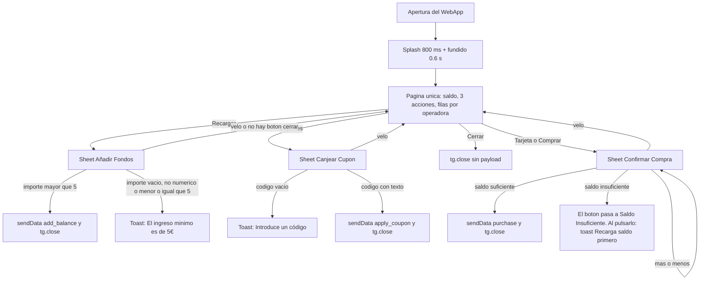

No hay botón de atrás. El único cierre de un sheet es pulsar el velo (`#overlay`, línea 624, `onclick="closeAllSheets()"`). No hay listener de Escape. Cerrar un sheet no devuelve foco al botón que lo abrió.

### 2.2 Splash

`index.html` 576-581 y CSS 481-534.

- Capa fija a toda la ventana, `z-index: 99999`.
- Fondo `rgba(11, 12, 16, 0.65)` con `backdrop-filter: blur(25px)` y el prefijo webkit. En la captura se ve el logo nítido y el fondo casi negro; el desenfoque del contenido de detrás casi no se aprecia porque el propio fondo ya es `#0b0c10`.
- Logo 180×180, radio 24, sin sombra de caja (`box-shadow:none` inline pisa la de la clase), con el drop-shadow violeta.
- Debajo, el spinner de 32 px. No hay texto, ni porcentaje, ni nombre de marca.
- A los 800 ms se añade `.hidden`. El nodo no se borra del DOM: se queda con `visibility: hidden` y `pointer-events` implícitos de un elemento invisible. `opacity` y `visibility` animan 0.6 s y el nodo escala a 1.05.

Estados: no hay splash de error. Si el parseo del catálogo falla, el splash dura lo mismo y luego se ve el catálogo de reserva (apartado 4.2).

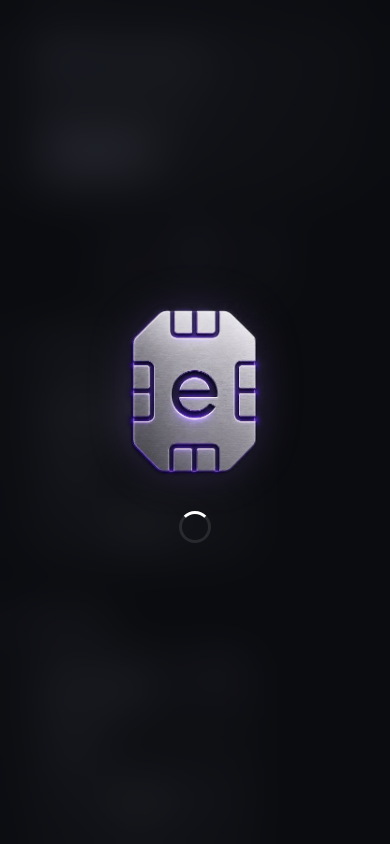

### 2.3 Página única

Orden vertical, sin rejilla:

1. `.wallet-container` > `.virtual-card.violet-ui` (585-600).
2. `.quick-actions` con tres botones (603-616).
3. `#providersContainer`, vacío en el HTML y rellenado por `renderCarousel` (618-621, 781-817).

Textos fijos de esta página:

| Texto | Dónde |
|---|---|
| `eSim Market` | 590 |
| `Fondos Disponibles` | 595 |
| `€` | 597 y otra vez al pintar el saldo (743) |
| `Recargar` | 606 |
| `Cupones` | 610 |
| `Cerrar` | 614 |
| `OFERTA` | solo si `hasBulkDiscount` (802) |
| `Comprar` | 809 |

Textos que vienen de los datos, no del HTML: nombre de operadora, nombre de producto, descripción y precio. La descripción de reserva si el objeto no trae `description` es `Conexión premium` (708).

La captura con catálogo de prueba, a 390 px. Cada operadora es un bloque. Las tarjetas miden 240 px, no el ancho de la pantalla. Lyca Mobile y «Otras Tarifas 20GB» comparten fila porque ninguna de las dos palabras está en `getProviderName`, y la segunda tarjeta se corta:

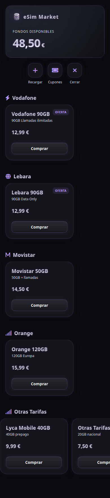

La misma página a 1440 px. La tarjeta de saldo ocupa 1400 px de ancho y sigue midiendo 184 px de alto. Las de producto siguen en 240 px, pegadas a la izquierda:

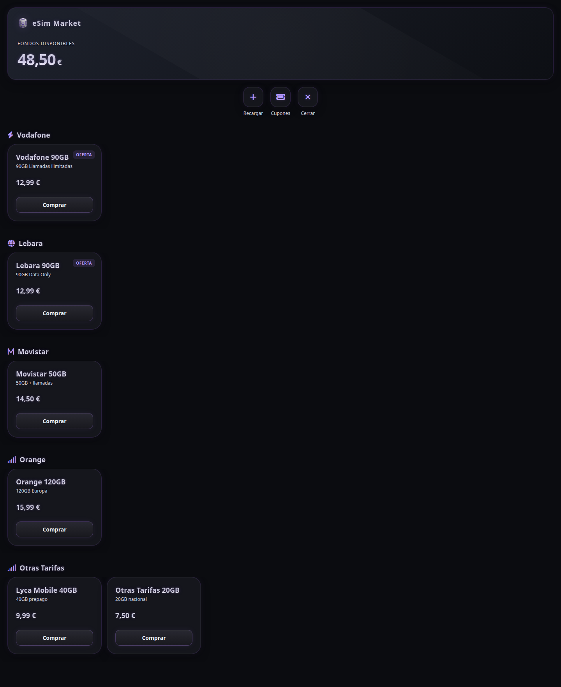

El primer pantallazo, sin bajar:

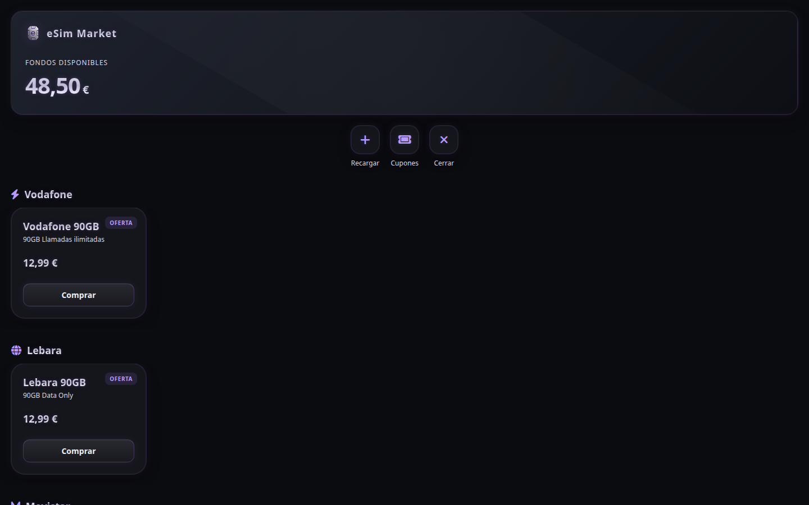

Fila con cuatro productos cuyo nombre contiene «vodafone», a 390 px. No hay barra ni flechas. La segunda tarjeta queda cortada por el borde:

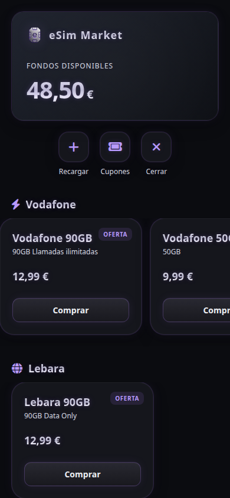

Las mismas cuatro tarjetas a 1440 px caben y dejan el resto de la fila vacío. Solo la de `id` exactamente `vodafone` lleva `OFERTA`. Las otras tres se llaman Vodafone en el título, pero su `id` es otro y no llevan pastilla:

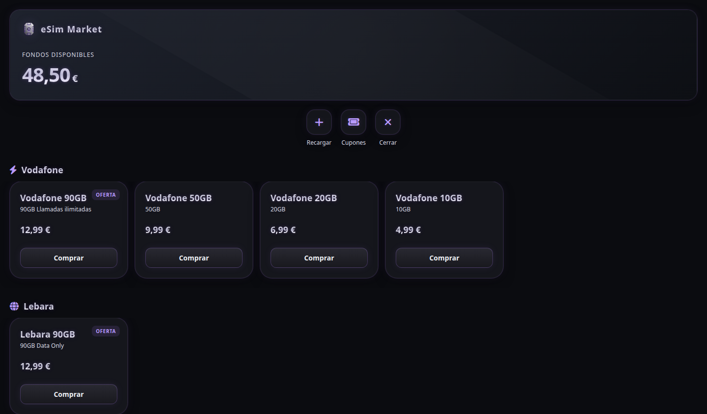

No hay cabecera de navegación, ni barra inferior, ni buscador, ni pestañas, ni pie, ni enlace a soporte, ni idioma, ni moneda.

### 2.4 Sheet «Añadir Fondos»

`index.html` 627-634. Se abre con el botón Recargar (`openSheet('rechargeSheet')`, 604).

Textos literales:

- Título: `Añadir Fondos`
- Subtítulo: `Introduce la cantidad que deseas depositar`
- Placeholder del input: `5.00`
- Botón: `Continuar al Pago`

El input es `type="number"`, `id="recharge-amount"`, `min="5"`, `step="0.01"` (632). No hay importes rápidos. No hay métodos de pago, ni PayPal, ni tarjeta, ni cripto, en esta hoja.

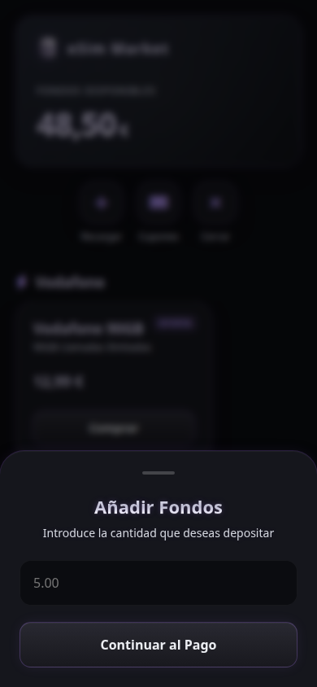

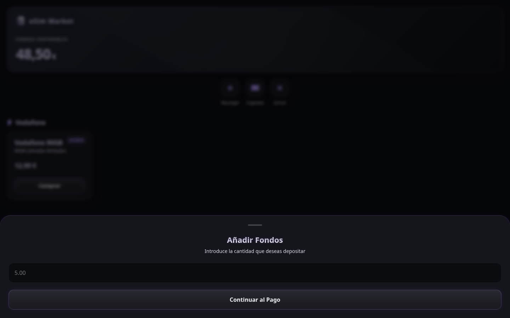

### 2.5 Sheet «Canjear Cupón»

`index.html` 637-644. Botón Cupones.

Textos literales:

- Título: `Canjear Cupón`
- Subtítulo: `Introduce el código promocional`
- Placeholder: `CÓDIGO`
- Botón: `Validar Código`

Un solo input `type="text"`, `id="coupon-code"` (642). No se transforma a mayúsculas. No se muestra el descuento en esta página: al validar, la mini app se cierra.

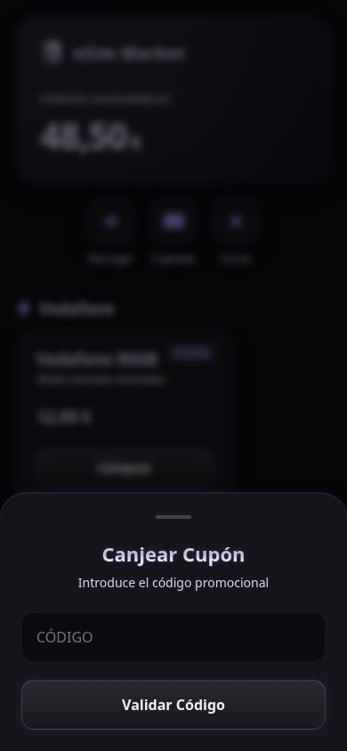

### 2.6 Sheet «Confirmar Compra»

`index.html` 647-673. Se abre al pulsar la tarjeta o el botón Comprar. Los dos llaman a `initPurchase` (804 y 809).

Textos literales de la estructura:

- Título: `Confirmar Compra`
- Stepper: el número, y detrás el texto fijo ` uds.`
- Filas: `Producto`, `Precio Ud.`, `Total a pagar`
- Botón inicial del HTML: `Confirmar Pago`

El HTML trae unos valores de ejemplo (`Vodafone 90GB`, `12.99 €`) en las líneas 660-668. No se llegan a ver: `initPurchase` llama a `updatePurchaseUI` antes de `openSheet` (828-832).

Con saldo 48,50 € y una unidad de Vodafone a 12,99 € el botón queda en plata (`#c7cbd6`) con texto blanco:

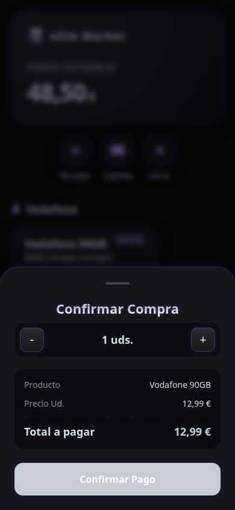

Con 4 unidades el precio unitario baja a 12,50 € por el tramo `{min: 2, price: 12.5}`, el total es 50,00 € y el botón pasa a «Saldo Insuficiente»:

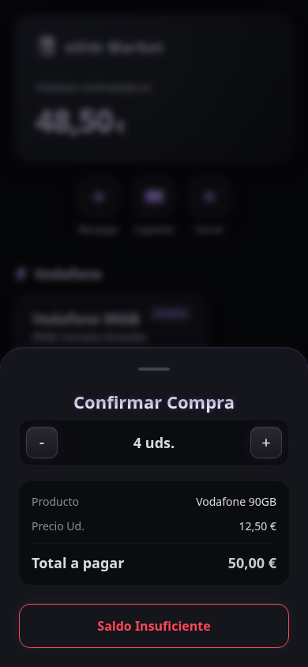

La misma hoja con saldo, a 1440 px. El `-` y el `+` se van a los extremos porque el stepper es `justify-content: space-between` y el sheet mide el ancho de la ventana:

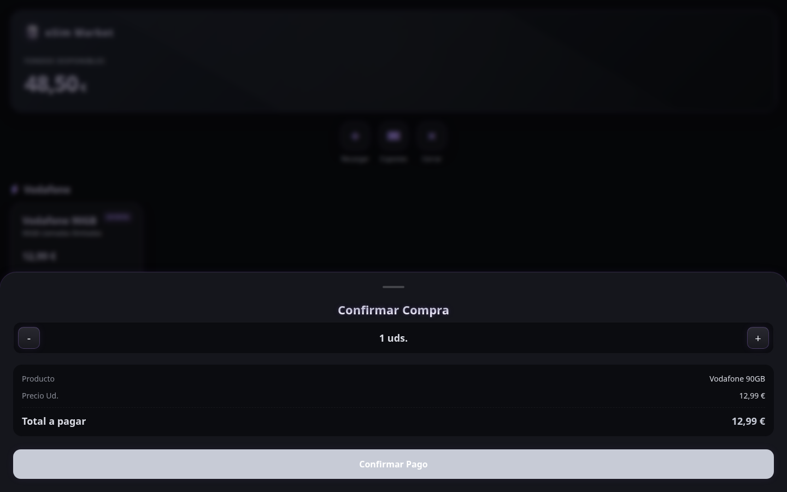

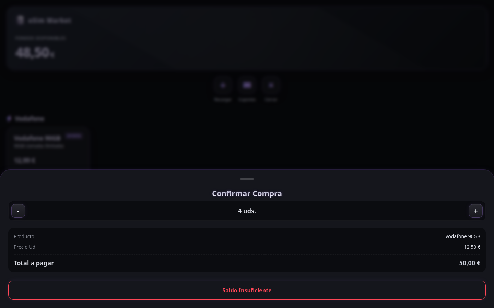

No hay campo de dirección, de email, de ICCID ni de país. No hay línea de envío. No hay cupón dentro de esta hoja.

### 2.7 Toast

HTML 676-679, CSS 454-477, función 746-751.

- Un solo nodo, `#toastMsg`.
- Icono fijo `fa-circle-info`. No hay variante de éxito ni de error: la clase no cambia.
- Posición: `top: 20px`, centrado con `left: 50%` y `translateX(-50%)`. Entra desde `translateY(-20px)`.
- Radio 30 px, padding `14px 24px`, gap 10 px, sombra `0 10px 30px rgba(0,0,0,0.5)`, fondo `--bg-card`, borde `--border-subtle`.
- Dura 3000 ms.
- No tiene `max-width` ni `white-space: nowrap`. El texto parte y, en 390 px, monta encima del logo.

Textos que el JS mete ahí:

| Mensaje | Cuándo | Línea |
|---|---|---|
| `El ingreso minimo es de 5€` | Recarga vacía, no numérica, o `<= 5`. Sin tilde en «minimo». | 898 |
| `Introduce un código` | Cupón vacío o solo espacios | 908 |
| `Recarga saldo primero` | Pulsar el botón cuando ya está en estado sin saldo | 859 |
| `Saldo Insuficiente` | `executePurchase` si el saldo no llega. Este camino queda tapado por el botón, que ya no llama a `executePurchase` | 875 |

El texto inicial del HTML es `Mensaje` (678). Se sustituye antes de mostrar el toast.

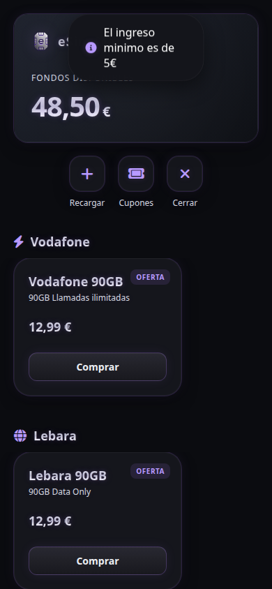

### 2.8 Estados de la tienda vigente

| Estado | ¿Existe? | Qué hace el código |
|---|---|---|
| Carga | Sí, solo visual | Splash 800 ms + fundido 0.6 s. No espera a una red. El catálogo se lee en sincrónico de la query. |
| Vacío de catálogo | No como pantalla | Si `products` falta, viene mal formado o es `[]`, `products.length === 0` y se pintan dos productos de reserva (719-724). No hay ilustración ni frase de «sin productos». |
| Error de datos | Solo consola | `console.error("Error parse:", e)` (716). El usuario ve el catálogo de reserva, no un mensaje. |
| Error de validación | Toast | Los cuatro textos de la tabla anterior. |
| Sin saldo | Sí | El botón cambia de aspecto y de texto. No abre la recarga solo. |
| Éxito de compra, de recarga o de cupón | No | `sendData` y `tg.close()` inmediato. No hay pantalla de gracias, ni QR, ni número de pedido. |
| Red caída | No aplica | Esta página no hace `fetch`. |

### 2.9 Agrupación por operadora

`getProviderName` (765-772) mira el nombre en minúsculas, no el `id`:

| Si el nombre incluye | Grupo | Icono |
|---|---|---|
| `vodafone` | `Vodafone` | `fa-bolt` |
| `lebara` | `Lebara` | `fa-globe` |
| `movistar` | `Movistar` | `fa-m` |
| `orange` | `Orange` | `fa-signal` |
| cualquier otra cosa | `Otras Tarifas` | `fa-signal` |

El orden de los grupos es el orden de primera aparición en el array. No se ordena alfabéticamente ni por precio.

## 3. Catálogo de componentes de la tienda vigente

No hay librería de componentes. Cada pieza es una clase CSS y, en tres casos, un estilo que el JS escribe en el nodo.

### 3.1 Botón de acción (Recargar, Cupones, Cerrar)

Clases `.action-btn` > `.action-icon.violet-ui` > `i`, más `.action-label.metal-soft`.

- El botón no tiene fondo ni borde (`background: none`, `border: none`, 117-118).
- El icono es una caja de 50×50, radio 16, fondo `--bg-card`, icono a 20 px en `#b89aff`, borde `--border-subtle`, sombra `0 8px 16px rgba(0,0,0,0.2)`, más el anillo de `.violet-ui`.
- Al pulsar: escala 0.92 y fondo `#1c1d24`, en 0.2 s.
- No hay `:hover`. En escritorio no hay cambio al pasar el ratón.
- La etiqueta va a 12 px, peso 500, color `#d5d8e0` por `metal-soft`.
- Los tres botones van en fila, centrados, `gap: 20px` (107-112). No se estiran.

### 3.2 Botón «Comprar»

Clases `.btn-buy.violet-btn` más estilo inline `margin-top:10px; padding:10px; font-size:14px` (809).

- Ancho 100 % de la tarjeta (que mide 240 px).
- Fondo: el degradado metal de `.violet-btn`. Texto `#eceef3`. Borde `rgba(173,124,255,0.26)`. Radio 12 px (de `.btn-buy`, no los 14 px de `.btn-primary`). Peso 700.
- `:active` de `.btn-buy` escala a 0.96. `:active` de `.violet-btn` escala a 0.97. Las dos clases están en el mismo nodo.
- `event.stopPropagation()` para que el clic del botón no dispare también el clic de la tarjeta. Los dos abren la misma hoja.
- No hay estado deshabilitado ni «sin stock» en esta tienda.

### 3.3 Botón primario de los sheets

Clases `.btn-primary.violet-btn`. Lo usan «Continuar al Pago» y «Validar Código».

- Ancho 100 %, padding 16 px, radio 14 px, texto 16 px, peso 600, color `#eceef3`.
- Degradado metal, borde violeta translúcido, sombra interior blanca y glow `rgba(173,124,255,0.08)`. La sombra `0 4px 15px var(--accent-glow)` de `.btn-primary` la pisa `.violet-btn`, que va después en el archivo.
- `:active` escala 0.97.
- El `onclick` inline de estos dos botones llama antes a `tg.HapticFeedback.impactOccurred('medium')` (633 y 643).

### 3.4 Botón «Confirmar Pago» en ejecución

Es el mismo nodo `#btn-execute`, pero `updatePurchaseUI` (853-866) le borra el aspecto metal en cuanto se abre la hoja.

Con saldo suficiente:

- `background: var(--accent)` → `#c7cbd6`
- `color: white`
- `border: none`
- texto `Confirmar Pago`
- `onclick` pasa a ser solo `executePurchase`. Se pierde el háptico `medium` que tenía el HTML (672), porque ese `onclick` se sustituye.

Sin saldo:

- `background: var(--bg-card)` → `#15161c`
- `color: var(--danger)` → `#ff4757`
- `border: 1px solid var(--danger)`
- texto `Saldo Insuficiente`
- `onclick` muestra el toast `Recarga saldo primero` y no abre la recarga.

El contraste de blanco sobre `#c7cbd6` es el que se ve en la captura. No es el degradado metal de «Comprar».

### 3.5 Botones del stepper

`.step-btn.violet-btn`, 40×40, radio 10, texto 20 px, fondo de clase `--bg-card` pisado por el degradado de `.violet-btn`. Signos literales `-` y `+` (652-655). Mínimo 1, máximo 50 (838-839). Háptico `light` en cada cambio (836).

### 3.6 Tarjeta de saldo

`.virtual-card.violet-ui` dentro de `.wallet-container`.

- Degradado `#1e222d` → `#0d0f14` a 135 grados, radio 20, padding 24, borde `--border-subtle`, `overflow: hidden`. La sombra que se pinta es la de `.violet-ui` (apartado 1.7), no la `0 15px 35px` de `.virtual-card`.
- Cabecera en flex, espacio entre extremos, `margin-bottom: 30px`.
- Izquierda: PNG a 28 px + `eSim Market` a 18 px / 800 / tracking 1 px, con texto metal.
- Derecha: el `<i class="fa-nfc-symbol">` que no pinta glifo con FA 6.0.0.
- Etiqueta `Fondos Disponibles` a 12 px, mayúsculas, tracking 1 px, color `#d5d8e0`.
- Importe a 40 px / 700 / tracking -1 px, texto metal. El `€` a 20 px en `--text-muted`.
- Medida real: 350×184 a 390 px de viewport; 1400×184 a 1440 px. El contenido no se redistribuye: el importe sigue a la izquierda. No está centrado.

### 3.7 Tarjeta de producto

`.product-card.violet-ui`.

- `flex: 0 0 240px`, alto de contenido medido en 197 px, radio 24, padding 20, fondo `--bg-card`, borde `--border-subtle`. La sombra que se pinta es la de `.violet-ui`. La declaración `0 10px 20px rgba(0,0,0,0.15)` de `.product-card` pierde la cascada.
- `scroll-snap-align: start` (232).
- Pastilla absoluta `top: 15px; right: 15px` solo con descuento por volumen.
- No pinta icono de operadora dentro de la tarjeta. El icono está en la cabecera del grupo.
- Nombre a 18 px (inline), descripción a 12 px, precio a 18 px, todos con texto metal salvo la descripción, que lleva `metal-soft`.
- Toda la tarjeta es clicable.

### 3.8 Pastilla `OFERTA`

`.product-badge`. Absoluta, fondo `rgba(173,124,255,0.12)`, texto `#b89aff`, padding `4px 8px`, radio 8, 10 px, peso 700, tracking 0.5 px. Una sola palabra, siempre `OFERTA`. No hay pastilla de stock, de 5G ni de «digital».

### 3.9 Cabecera de operadora

`.provider-header`: padding `0 20px`, margen inferior 12 px, flex, gap 10 px. Icono a 18 px en `#b89aff` con el glow de la línea 568. Título a 18 px / 700 con texto metal. No hay enlace «ver todo».

### 3.10 Fila horizontal

`.products-row`: flex, `overflow-x: auto`, padding `0 20px 20px`, gap 15 px, `scroll-snap-type: x mandatory`, `scrollbar-width: none` y `::-webkit-scrollbar { display: none }` (177-188). En escritorio no hay manera visible de saber que la fila continúa, y no hay botones de avance.

### 3.11 Input

`.input-styled`. Ancho 100 %, fondo `--bg-base`, borde `--border-subtle`, padding 16, radio 14, texto blanco a 16 px, `outline: none`, margen inferior 20 px. Foco: borde `#b89aff` en 0.2 s.

Variantes reales: `type="number"` (recarga) y `type="text"` (cupón). No hay label asociado, ni texto de ayuda, ni estado de error en el propio campo: el error va al toast. No hay límite de caracteres en el cupón.

### 3.12 Stepper

`.stepper`: flex, `space-between`, fondo `--bg-base`, radio 14, padding 8, margen inferior 20, borde `--border-subtle`. En una hoja de 1440 px los botones se separan hasta los bordes del sheet. El valor es el número más el literal ` uds.`

### 3.13 Recibo

`.receipt-box`: fondo `--bg-base`, radio 16, padding 16, margen inferior 24. Filas a 14 px con `space-between` y 12 px entre ellas. La última fila suma `padding-top: 12px`, borde superior discontinuo y pasa a 18 px / 700. No se calcula IVA ni se desglosa el descuento en la hoja, aunque el payload sí manda `discountAmount` (apartado 4.5).

### 3.14 Sheet y velo

- Velo `.sheet-overlay`: fijo, `rgba(0,0,0,0.5)`, `backdrop-filter: blur(4px)`, z-index 1000, opacidad 0 hasta `.active`, transición 0.3 s.
- Hoja `.bottom-sheet.violet-ui`: fija, `bottom: -100%` hasta `.active`, radio superior 30, padding 24, fondo `--bg-card`, borde superior `--border-subtle`, z-index 1001, transición de `bottom` 0.4 s con la curva de rebote. Declara `box-shadow: 0 -20px 40px rgba(0,0,0,0.5)` (331), pero `.violet-ui` va después y sustituye esa sombra por su anillo. El color de texto de la hoja es el `#d9dbe3` de `.violet-ui`, salvo donde `.metal-text` recorta el degradado con `-webkit-text-fill-color: transparent`.
- Asa: 40×4, radio 2, `rgba(255,255,255,0.2)`, centrada, margen inferior 24. No se puede arrastrar. Es decorativa.
- No hay tope de altura ni scroll interno. Con poco contenido la hoja mide lo que mide su contenido y se pega al fondo de la ventana. A 1440 px ese fondo es todo el ancho.

### 3.15 Toast

Descrito en 2.7. Una sola variante visual.

### 3.16 Lo que esta tienda no tiene como componente

No hay pestañas, ni barra inferior, ni menú lateral, ni cabecera con botón atrás, ni tarjeta de reseña, ni badge de stock, ni chip de importe, ni lista vertical de pedidos, ni campo de búsqueda, ni selector de idioma, ni selector de moneda, ni avatar, ni diálogo modal centrado, ni tooltip, ni skeleton, ni paginación.

## 4. Funcionalidad de la tienda vigente

### 4.1 Arranque y Telegram

Métodos de Telegram que esta página llama:

| Método | Dónde | Para qué |
|---|---|---|
| `expand()` | 683 | Pedir al cliente que abra el WebApp a altura completa. |
| `ready()` | 684 | Avisar de que la página ya puede mostrarse. |
| `setHeaderColor('#0b0c10')` | 685 | Cromo superior. |
| `setBackgroundColor('#0b0c10')` | 686 | Fondo del cliente. |
| `HapticFeedback.impactOccurred('light')` | 804, 809, 836 | Al pulsar tarjeta, Comprar o el stepper. |
| `HapticFeedback.impactOccurred('medium')` | 633, 643, y el HTML inicial de 672 | Recarga, cupón, y el botón de pago solo antes de que `updatePurchaseUI` sustituya el `onclick`. |
| `sendData(json)` | 890, 901, 911 | Única salida de datos. |
| `close()` | 613, 891, 902, 912 | Cerrar el WebApp. El botón Cerrar no manda payload. |

No se usan `initData`, `initDataUnsafe`, `themeParams`, `colorScheme`, `MainButton`, `BackButton`, `showAlert`, `showConfirm`, `openInvoice`, `openLink`, `openTelegramLink`, `CloudStorage`, `BiometricManager` ni `onEvent`.

El háptico de «Confirmar Pago» se pierde en cuanto la hoja se abre, por la reasignación de `onclick` de las líneas 859 y 864.

### 4.2 Entrada de datos

Solo la query string. No hay `fetch`, ni `XMLHttpRequest`, ni `WebSocket`, ni supabase, ni body de formulario.

| Parámetro | Lectura | Si falta o falla |
|---|---|---|
| `balance` | `parseFloat(urlParams.get('balance')) \|\| 0` (696) | Saldo 0. Un valor no numérico también cae a 0 porque `parseFloat` da `NaN` y `NaN \|\| 0` es 0. |
| `products` | `decodeURIComponent`, luego `atob`, luego `JSON.parse` (699-703) | Cualquier excepción deja el array vacío y entra el catálogo de reserva. Un array vacío también entra en el reserva, porque se mira `length === 0` (719). |

Campos que se leen de cada producto (705-714):

| Campo de entrada | Destino | Notas |
|---|---|---|
| `id` | `id` | Comparación exacta, sensible a mayúsculas, contra `"vodafone"` y `"lebara"`. |
| `name` | `name` | También decide el grupo de operadora. |
| `description` | `description` | Si falta: `Conexión premium`. |
| `unit_price` | `basePrice` con `parseFloat`. Si falta o no es número: 0. | No se leen `price`, `sale_price` ni `unitPrice` en esta tienda. Esos alias solo existen en el parche. |

Campos que el objeto podría traer y esta página ignora: stock, tipo, compañía, tarifa, moneda, país, imagen, QR, duración.

El descuento por volumen no viene en los datos. Se fabrica en el cliente (710-714):

- Si `id` es exactamente `vodafone` o exactamente `lebara`: `hasBulkDiscount: true` y tramos `[{min:20, price:10}, {min:10, price:11}, {min:5, price:12}, {min:2, price:12.5}]`.
- Cualquier otro `id`, aunque el nombre diga Vodafone: sin descuento y sin pastilla.

Catálogo de reserva, solo si el array acaba vacío (722-723):

| id | name | description | basePrice | Descuento | Tramos |
|---|---|---|---|---|---|
| `vodafone` | `Vodafone` | `90GB Llamadas` | 12.99 | sí | solo `{min: 2, price: 12.5}` |
| `lebara` | `Lebara` | `90GB Data Only` | 12.99 | no | ninguno |

El reserva no es el mismo descuento que el camino con query. Lebara de reserva no tiene oferta. Vodafone de reserva solo tiene el tramo de 2 unidades, no los de 5, 10 y 20.

### 4.3 Precio por cantidad

`getUnitPrice` (820-826) recorre los tramos en el orden del array y se queda con el primero cuyo `min` sea menor o igual que la cantidad. El orden descendente es lo que hace que funcione. Si un tramo de `min: 2` fuera el primero, todas las cantidades devolverían 12.5.

Con el catálogo que llega por query, para Vodafone y Lebara:

| Cantidad | Precio unitario | Motivo |
|---|---|---|
| 1 | `basePrice` (en la captura, 12,99 €) | Ningún tramo cumple. |
| 2 a 4 | 12,50 € | Primer tramo que cumple: `min: 2`. |
| 5 a 9 | 12,00 € | `min: 5`. |
| 10 a 19 | 11,00 € | `min: 10`. |
| 20 a 50 | 10,00 € | `min: 20`. |

La cantidad se recorta a 1…50 (837-839). No hay descuento de cupón dentro de este cálculo. `discountAmount` del payload es solo la diferencia entre `basePrice * cantidad` y el precio con tramo (882-888).

### 4.4 Acciones del usuario

| Acción | Resultado |
|---|---|
| Esperar al splash | A los 800 ms empieza el fundido. |
| Pulsar Recargar | Háptico no, en este botón: el `onclick` solo abre el sheet (604). El háptico `medium` está en «Continuar al Pago». |
| Escribir un importe y pulsar «Continuar al Pago» | Ver 4.5. |
| Pulsar Cupones | Abre el sheet. |
| Escribir un código y pulsar «Validar Código» | Ver 4.5. |
| Pulsar Cerrar | `tg.close()` sin datos (613). |
| Pulsar una tarjeta o Comprar | Háptico `light`, abre la hoja de compra con cantidad 1. |
| Pulsar `-` o `+` | Háptico `light`, recorta a 1…50, recalcula. |
| Pulsar «Confirmar Pago» con saldo | `sendData` de compra y cierre. |
| Pulsar «Saldo Insuficiente» | Toast `Recarga saldo primero`. No navega. |
| Pulsar el velo | Cierra todas las hojas. No hay forma de cerrar una y dejar otra: `closeAllSheets` quita `.active` a todos los `.bottom-sheet` (759-761). |
| Cambiar de idioma, de moneda, buscar un país, abrir un pedido, enseñar un QR, hablar con soporte | No hay control para eso. |

### 4.5 Salidas `sendData`

Tres payloads. Los tres hacen `JSON.stringify`, `tg.sendData` y, en la línea siguiente, `tg.close()`. No hay espera de respuesta. No hay reintento. Si `sendData` lanza, la excepción no se captura en esta página.

Compra (`executePurchase`, 879-891):

```json
{
  "type": "purchase",
  "productId": "<id>",
  "productName": "<name>",
  "quantity": 1,
  "unitPrice": 12.99,
  "totalPrice": 12.99,
  "originalTotal": 12.99,
  "discountAmount": 0
}
```

`quantity`, `unitPrice`, `totalPrice`, `originalTotal` y `discountAmount` son números, no strings. `originalTotal` es `basePrice * quantity`. `discountAmount` es `originalTotal - totalPrice`. Con una unidad el descuento es 0. Con cuatro unidades de un producto a 12,99 € y tramo 12,50 €, `originalTotal` es 51,96 y `discountAmount` es 1,96.

Recarga (`confirmRecharge`, 895-902):

```json
{ "type": "add_balance", "amount": 10 }
```

`amount` es el número de `parseFloat`, no una cadena con dos decimales. La condición de rechazo es `isNaN(val) || val <= 5` (897). El placeholder dice `5.00` y el toast dice `El ingreso minimo es de 5€`, pero 5 y 5.00 se rechazan. El primer valor que pasa es cualquier número estrictamente mayor que 5, por ejemplo 5.01. No hay importe máximo.

Cupón (`applyCoupon`, 905-912):

```json
{ "type": "apply_coupon", "code": "<texto recortado, sin cambiar mayúsculas>" }
```

Si `trim()` queda vacío: toast `Introduce un código` y no se envía nada.

No hay un cuarto tipo. No se manda el saldo, ni el `initData`, ni el id de usuario, ni la plataforma.

### 4.6 Auth

No hay inicio de sesión en esta página. No se lee `tg.initData` ni `tg.initDataUnsafe.user`. No hay correo, ni contraseña, ni código de un solo uso, ni captcha, ni comprobación «9+4».

La identidad, si existe, la ha resuelto el bot antes de abrir el WebApp y la ha metido en la query. El HTML confía en `balance` y `products` sin firmarlos. Cualquiera que abra el archivo ve el catálogo de reserva. `sendData` solo lo entrega el cliente de Telegram; fuera de Telegram el script oficial no tiene a quién entregar el JSON. Ese cliente no está en este repositorio.

### 4.7 Saldo, pago, compra y entrega

Lo que la pantalla hace con el dinero:

- Muestra el número recibido en `balance`.
- Lo compara con `precioUnitario * cantidad` para dejar o no pulsar el pago (854, 874).
- No lo descuenta en local. Al cerrarse, no hay un saldo nuevo pintado.
- «Continuar al Pago» no abre una URL, ni Stripe, ni PayPal, ni un invoice de Telegram. Manda `{type:"add_balance", amount}` y cierra.
- No hay historial, ni factura, ni id de pago, ni estado «pendiente», ni enlace para retomar un pago abandonado.
- No hay pantalla de QR, ni de código de activación, ni de LPA, ni de instrucciones de instalación. La entrega, si ocurre, ocurre en el bot después de `sendData`. El bot no está en este repositorio.
- No hay alquiler de números SMS. No hay una sola pantalla, campo o endpoint con ese flujo. La búsqueda de `sms` / `SMS` en los HTML no encuentra un producto de alquiler.
- No hay buscador de país, ni lista de países, ni filtro.
- No hay carrito. Comprar abre la hoja de un solo producto.
- No hay reseñas.
- No hay notificaciones, ni bandeja, ni permiso de push. El único aviso es el toast.
- No hay soporte: ni botón, ni `t.me`, ni texto de ayuda.
- No hay i18n. Los textos están escritos en español en el HTML y en el JS. No hay diccionario ni conmutador.
- No hay más moneda que el euro. El símbolo está en el HTML, no en los datos.

### 4.8 Lo que hay en la línea 3 y no es la tienda

`index.html` línea 3 carga un script de `https://ppl-ai-code-interpreter-files.s3.amazonaws.com/` con una clave larga. Ninguna función de la página lo referencia. No forma parte del saldo, del catálogo ni de los colores. En las capturas esa petición se bloqueó y no se ejecutó. Hay que decidir si debe seguir en el archivo antes de copiar esta página a ningún sitio.

### 4.9 Proyecto React de `project/`

No es la mini app.

- `project/package.json`: nombre `vite-react-typescript-starter`. Dependencias de ejecución: `@supabase/supabase-js`, `lucide-react`, `react`, `react-dom`. No hay ningún `import` de supabase ni de lucide en `project/src`.
- `project/src/App.tsx` líneas 1-7 renderizan un fondo `bg-gray-100` y el texto `Start prompting (or editing) to see magic happen :)`.
- `project/tailwind.config.js` no extiende colores ni fuentes.
- `project/src/index.css` solo tiene las tres directivas de Tailwind.
- No existe `project/index.html`. El `index.html` de la tienda está en la raíz del repo, fuera del proyecto Vite. `npm run dev` dentro de `project/` no tiene el HTML de entrada que Vite espera.
- Este React no debe usarse como referencia visual.

## 5. Por qué se rompe a 1440 px

La causa no es un bug de una media query mal escrita. En `index.html` no hay ninguna `@media`. No hay `max-width` en `body`, ni en un contenedor, ni en el sheet.

1. La página es un documento de bloque al 100 % del viewport. `.wallet-container` solo resta 20 px por lado. A 1440 px la tarjeta mide 1400×184. El tipo del importe sigue a 40 px y alineado a la izquierda, así que la tarjeta parece una franja vacía. Captura: `screenshots/index-1440-home.png`.
2. `.quick-actions` es un flex centrado con `gap: 20px` y los iconos fijos a 50 px. En escritorio el grupo se queda en el centro y no acompaña a la tarjeta. No hay `:hover`, solo `:active`, pensado para el dedo.
3. `.product-card` es `flex: 0 0 240px` (línea 228). Medido: 240×197 en los dos viewports. Una operadora con una tarifa deja más de mil píxeles vacíos a la derecha. No hay `flex-grow`, ni rejilla, ni salto de línea.
4. `.products-row` es scroll horizontal con la barra oculta (`scrollbar-width: none` y `::-webkit-scrollbar { display: none }`, líneas 183-188). A 390 px, dos tarjetas de 240 px más el hueco de 15 px y el padding de 20 px suman 535 px de `scrollWidth` contra 390 px visibles: la segunda se corta y no hay pista de que se pueda arrastrar. A 1440 px cuatro tarjetas de Vodafone caben (empiezan en x = 20, 275, 530 y 785) y el resto de la fila queda negro. Capturas: `index-390-fila.png`, `index-1440-fila.png`, y el corte de «Otras Tarifas» en `index-390-home.png`.
5. `.bottom-sheet` es `left: 0; right: 0` (324). A 1440 px la hoja es una barra de 1440 px pegada al fondo. El input y el botón son `width: 100%`, así que el campo de importe y «Continuar al Pago» se estiran de borde a borde. Captura: `index-1440-recarga.png`.
6. El stepper es `justify-content: space-between` (415). En la hoja ancha el `-` y el `+` se separan hasta los extremos y el `1 uds.` se queda en el centro, lejos de los dos. Captura: `index-1440-compra.png`.
7. El recibo también es `space-between`. «Producto» y el nombre quedan en puntas opuestas de una fila de más de 1300 px.
8. El toast no tiene ancho máximo. En móvil el texto parte y tapa la marca (`index-390-toast.png`). En escritorio una frase corta se queda como una pastilla flotante, sin relación con un contenedor.
9. El splash es `position: fixed; inset: 0`, así que en escritorio es correcto como capa a pantalla completa, pero detrás ya está la página estirada. Al fundirse, lo que aparece es esa página.
10. `user-scalable=no` y `maximum-scale=1` (línea 5) no arreglan el ancho. Solo impiden pellizcar en el teléfono.
11. No hay menú lateral, ni columnas, ni pie. La definición de la web pide menú lateral. Esta mini app no lo tiene. El único menú lateral del repo está en `stats.html`, y es del admin.
12. `overflow-x: hidden` en `body` (35) recorta cualquier desborde horizontal en vez de ofrecer una página de escritorio. La fila de productos se salva porque su propio `overflow-x: auto` crea un scroll interno, con la barra escondida.

El panel de admin no sufre este problema: tiene sidebar de 220 px y media queries a 900 px y a 480 px. Eso se describe en el apartado 6.3 y no forma parte de la marca de la tienda.

## 6. Otras piezas del repositorio, que no son la tienda vigente

Se documentan para no tomarlas por la marca, y porque la definición nombra piezas (carrito, reseñas, admin) que solo aparecen aquí.

### 6.1 Parche `project/indexparche7.0.html`

Última actualización el 2026-06-11, once días antes que `index.html`. Es otra piel. Si la web copia estos hex, no está copiando la tienda vigente.

#### 6.1.1 Tokens

Líneas 10-27.

| Token | Valor |
|---|---|
| `--bg` | `#09090f` |
| `--bg-card` | `#111218` |
| `--bg-card2` | `#16171f` |
| `--bg-input` | `#0d0e15` |
| `--purple` | `#7c3aed` |
| `--purple-light` | `#9d6cf7` |
| `--purple-dim` | `rgba(124,58,237,0.18)` |
| `--purple-glow` | `rgba(124,58,237,0.35)` |
| `--purple-border` | `rgba(124,58,237,0.3)` |
| `--text` | `#f0f0f8` |
| `--text-muted` | `#6b6d80` |
| `--text-sub` | `#9899a8` |
| `--border` | `rgba(255,255,255,0.07)` |
| `--danger` | `#ef4444` |
| `--success` | `#22c55e` |
| `--r-card` | `20px` |
| `--r-btn` | `50px` |

Tipografía: la misma pila de sistema que la tienda (línea 34), más `-webkit-font-smoothing: antialiased`. `body` sí fija `font-size: 16px` y `line-height: 1.5` (35). Iconos: Font Awesome 6.4.0 (línea 8), que sí incluye `fa-sim-card`, `fa-qrcode` y `fa-nfc-symbol`, aunque este archivo no usa el de NFC.

Telegram: `setHeaderColor('#09090f')` y `setBackgroundColor('#09090f')` (757). Si no existe `window.Telegram`, las líneas 750-754 instalan un stub que hace `console.log` de `sendData`. La tienda vigente no tiene ese stub.

No hay `@media`. No hay `themeParams`. El viewport también lleva `user-scalable=no` (línea 5).

#### 6.1.2 Pantallas

Cuatro nodos `.screen`. Solo uno tiene `.active`. No hay URL por pantalla.

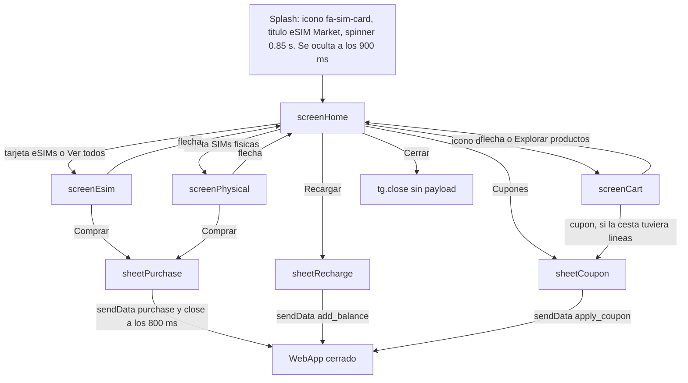

Splash (530-534): caja 96 px, radio 24, degradado `#1a0a35` → `#0f0820`, borde `--purple-border`, sombra `0 0 48px var(--purple-glow)`, icono `fa-sim-card` a 42 px en `--purple-light`. Título `eSIM Market` a 21 px / 700. Spinner 26 px, borde 2.5 px, vuelta en 0.85 s lineales. No usa el PNG del chip.

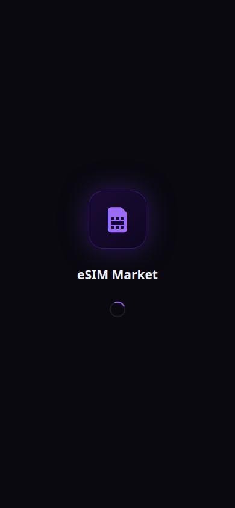

Home, de arriba abajo:

- Héroe con `background` `photo_2026-06-09_19-58-36.jpg` centrado y en cover (188), un velo `linear-gradient(180deg, rgba(9,9,15,0.35), rgba(9,9,15,0.15) 40%, rgba(9,9,15,0.7) 80%, var(--bg))` (192) y una línea inferior `linear-gradient(90deg, transparent, var(--purple-border), transparent)` (197).
- Marca: icono en caja 34 px, radio 10, degradado `#3b1a7e` → `#1a0a35`, más el texto `eSIM Market` a 15 px / 700 (586-588).
- Botón de bolsa 40×40, radio 12, fondo `rgba(124,58,237,0.14)`. El contador `#cartCount` está a `display: none` hasta que haya unidades (219-225, 849-853). En la UI nunca hay unidades, porque nadie llama a `addToCart`.
- Etiqueta `Fondos` a 11 px / 600, tracking 2 px, mayúsculas, color `--text-sub` (595).
- Importe a 52 px / 800, tracking -2 px, con animación `fadeUp` de 0.4 s (524, 231-234). El `€` va a 24 px / 600 en `--text-sub`.
- Las mismas tres acciones, pero el icono es un círculo de 54 px, no un cuadrado de 50. Etiqueta a 11 px. Textos: `Recargar`, `Cupones`, `Cerrar`.
- Sección `¿ Qué necesitas ?` con espacios dentro de los signos (617). Dos tarjetas.
- `Proveedores populares` y `Ver todos`, que abre el catálogo eSIM, no un listado de operadoras (648).
- `Reseñas de clientes`, tres tarjetas fijas.
- Franja de cuatro beneficios.

Textos de la tarjeta eSIM (620-628): pastilla `Digital`; título `eSIMs Digitales`; subtítulo `Actívalas al instante`; `Entrega por QR`; `Perfecto para viajes`; `Sin tarjeta física`; botón `Ver eSIMs`.

Textos de la tarjeta física (630-638): pastilla `Física`; título `SIMs Físicas`; subtítulo `Envío rápido a casa`; `Tarjeta SIM física`; `Envío seguro`; `Compatible todo`; botón `Ver SIMs`.

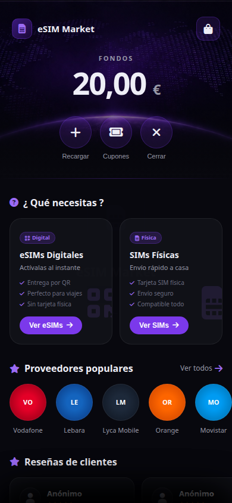

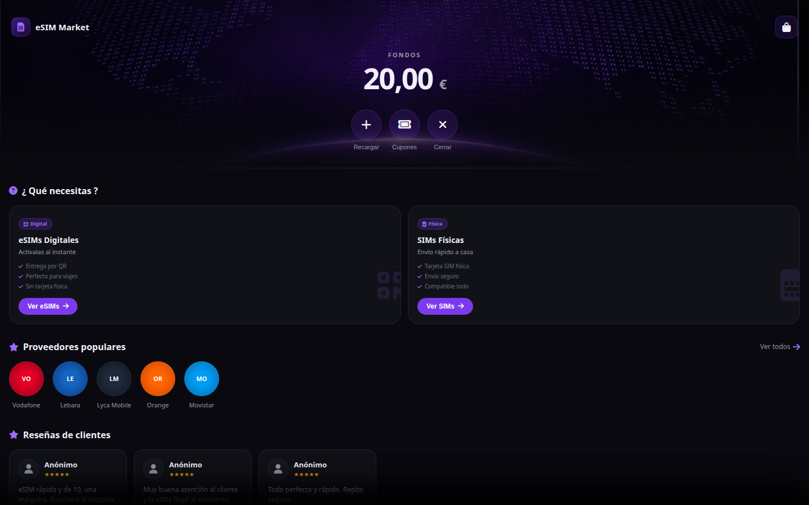

Reseñas, literales, las tres a nombre `Anónimo` con `★★★★★` en `#f59e0b` (341, 659-680):

1. `eSIM rápida y de 10, una máquina. Funcionó al instante sin problema.`
2. `Muy buena atención al cliente y la eSIM llegó al momento. Totalmente recomendable.`
3. `Todo perfecto y rápido. Repito seguro.`

No salen de una API. No hay formulario para dejar una reseña. La tarjeta mide `flex: 0 0 210px` (330) y la fila esconde la barra (324-328). A 390 px se ven dos y el principio de la tercera.

Beneficios (685-705), icono a 22 px en `--purple-light`, título a 10 px / 700, subtítulo a 9 px:

| Título | Subtítulo | Icono |
|---|---|---|
| `Entrega inmediata` | `Recibe tu eSIM al momento` | `fa-bolt` |
| `Seguro y confiable` | `Tus datos siempre protegidos` | `fa-shield-halved` |
| `Soporte 24/7` | `Estamos para ayudarte` | `fa-headset` |
| `Pago seguro` | `Compra con total seguridad` | `fa-lock` |

«Soporte 24/7» es un texto. No abre Telegram ni un ticket.

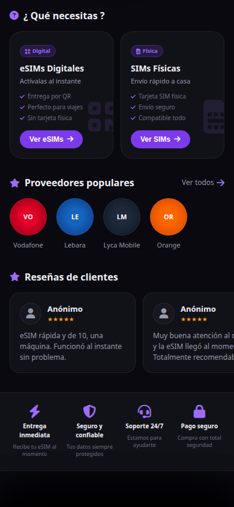

Avatares de operadora, 62×62, círculo, iniciales (866-871): dos palabras usan la inicial de cada una (`Lyca Mobile` → `LM`); una palabra usa las dos primeras letras (`Vodafone` → `VO`). Colores (316-321):

| Clase | Degradado radial |
|---|---|
| `prov-vodafone` | `#e60028` 30 % → `#8b0016` |
| `prov-lebara` | `#1565c0` 30 % → `#0a3880` |
| `prov-orange` | `#ff6600` 30 % → `#cc4400` |
| `prov-movistar` | `#019df4` 30 % → `#016fad` |
| `prov-lyca` | `#1e2a3b` 30 % → `#0f1520` |
| `prov-default` | `#3b1a7e` 30 % → `#1a0a35` |

Pulsar un avatar abre `screenEsim`, no filtra por esa operadora (878). Si no hay compañías: el texto `Sin proveedores` (876).

Catálogo eSIM, textos fijos (711-717): ceja `Conéctate al instante`; título `eSIMs para` más `todo el mundo` en `--purple-light`; línea `Entrega inmediata por QR`. El icono de fondo es `fa-qrcode` a 88 px, color `rgba(180,140,255,0.18)` (375-378). No es un código QR generado.

Catálogo físico (725-731): la misma ceja; título `SIMs para` / `todo el mundo`; línea `Envío seguro por toda la península`.

Cada producto pinta, como máximo, cuatro etiquetas (900-913): tarifa, descripción, y después `5G` y `Entrega inmediata` si es eSIM, o `Envío seguro` si es física. Precio con `money()` (802-804): dos decimales, coma, espacio y `€`. Botón `Comprar`, o `Sin stock` deshabilitado si `stock <= 0` (916-918). El botón deshabilitado usa fondo `--bg-card2` y texto `--text-muted` (423).

Vacío del catálogo (891-897): título `Sin productos` y el subtítulo `No hay eSIMs digitales disponibles ahora.` o `No hay SIMs físicas disponibles ahora.`

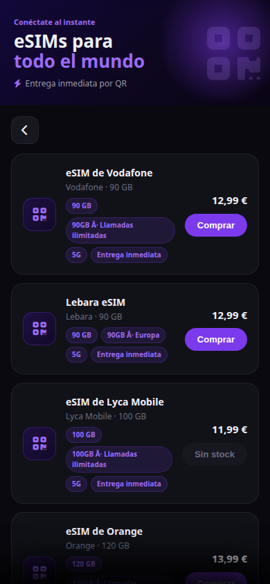

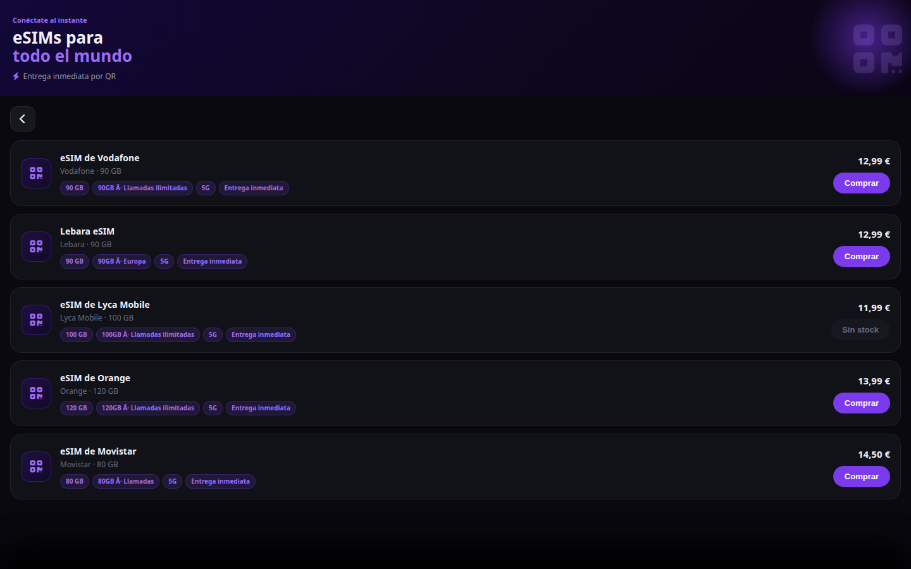

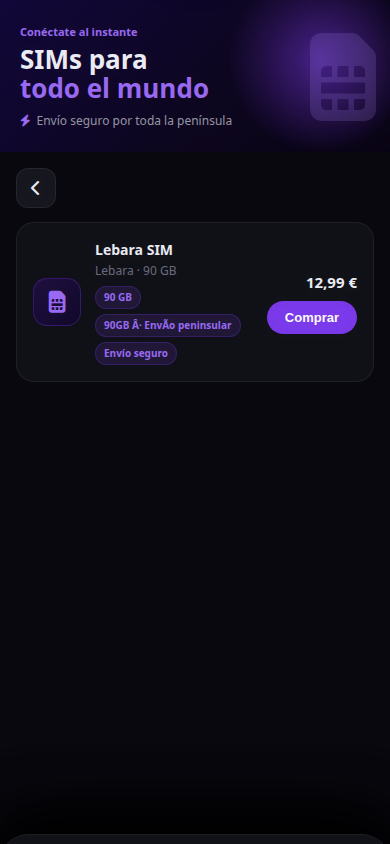

Cesta (737-746). Vacía, que es el único estado al que se llega con los botones:

- Título `Mi Cesta`
- `Tu cesta está vacía`
- `Añade productos desde el catálogo para comenzar tu pedido.`
- Botón `Explorar productos`, que vuelve al home (1054)

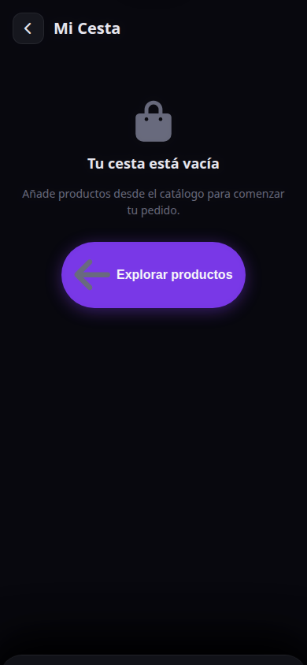

`addToCart` (1008-1016) no está en ningún `onclick`. La captura siguiente se obtuvo llamando a esa función desde la consola, para ver el CSS de una línea. No es un estado que el usuario pueda provocar:

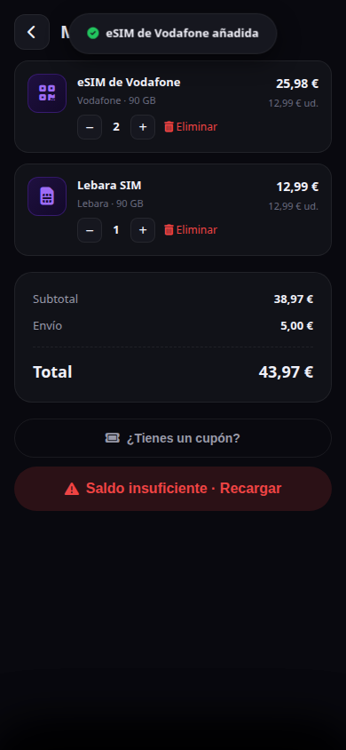

Textos de esa línea y del resumen, si alguna vez hubiera líneas: `Eliminar`, `Subtotal`, `Descuento`, `Envío`, `Total`, `Gratis`, `¿Tienes un cupón?`, `Confirmar pedido · {importe}`, y si no hay saldo `Saldo insuficiente · Recargar`. El envío es 5 € si alguna línea es `physical`, si no `Gratis` (1032-1043). El descuento solo se pinta si `S.coupon` tiene valor. Nada en el archivo asigna `S.coupon`. El badge `{code} aplicado` (1095) es código muerto.

Hoja de recarga (546-562). Título `Añadir Fondos`. Subtítulo `Selecciona o introduce la cantidad`. Importes `10 €`, `20 €`, `50 €`, `100 €`, `200 €`, `500 €`. Placeholder `Otra cantidad (€)`. Botón `Recargar Saldo`. No hay mínimo de 5 €: solo se rechaza un valor vacío, `NaN` o `<= 0`, con el toast `Introduce un importe válido` (1143). El chip seleccionado lleva la clase `.sel`: borde y fondo violeta, texto `--purple-light` (135-137).

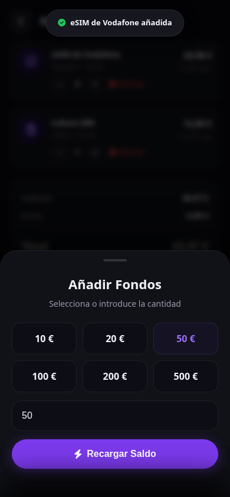

Hoja de cupón (565-573). Título `Cupón Promocional`. Subtítulo `Introduce tu código para aplicar el descuento`. Placeholder `Ej: ESIM20OFF`. Botón `Aplicar Cupón`. El código se manda en mayúsculas (1150). Toast si falta: `Introduce un código de cupón`.

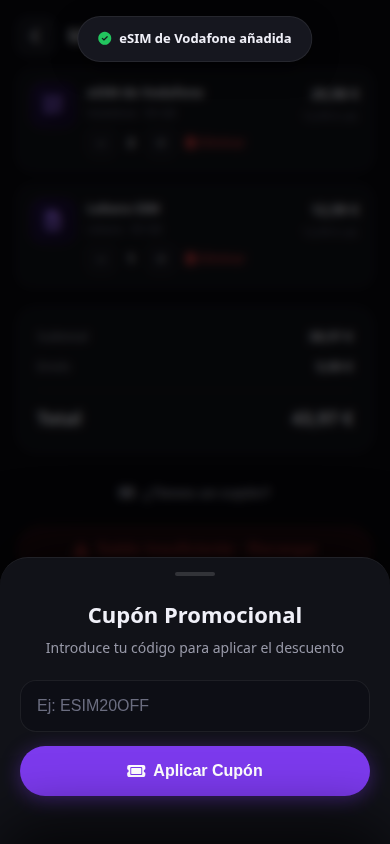

Hoja de compra. Título `Confirmar Compra` y el nombre del producto como subtítulo. Stepper con `1 ud.` o `N uds.` (950): aquí el singular sí existe, a diferencia de la tienda vigente. Filas: `Producto`, `Precio unitario`, `Cantidad`, `Envío InPost`, `Total`. El envío es `5` € si `typeProduct === 'physical'` y `Gratis` si no (941, 957). El 5 no se multiplica por la cantidad. Sin saldo, el texto es `Saldo insuficiente — recarga para continuar` y el botón `Recargar Saldo` abre la hoja de recarga (961-966). Con saldo, el botón dice `Confirmar Pago · {importe}`.

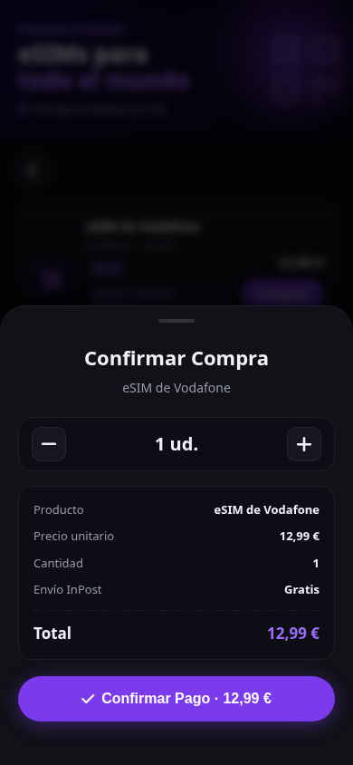

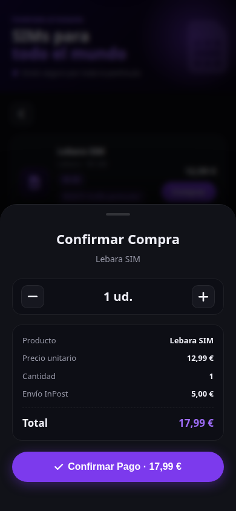

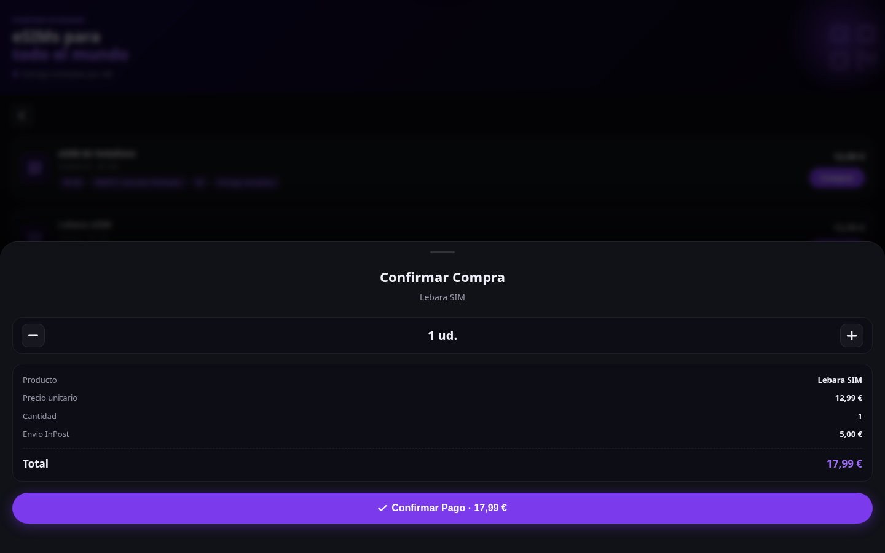

Toast del parche (70-84, 829-837): pastilla con `border-radius: 50px`, `top: 16px`, entra con `translateY(-80px)` en 0.35 s y la curva `cubic-bezier(0.32, 0.72, 0, 1)`, dura 3000 ms. Tipos: `success` icono `fa-circle-check` en `--success`; `error` icono `fa-circle-xmark` en `--danger`; si no, `fa-circle-info` en `--purple-light`. `white-space: nowrap` y `max-width: 90vw`.

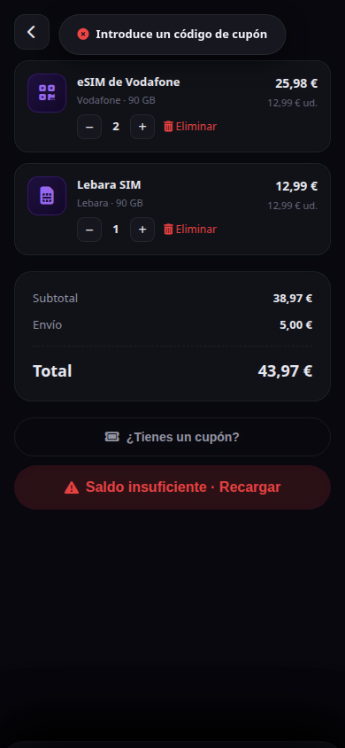

Otros toasts literales: `{nombre} añadida` (1015), `Saldo insuficiente` (990 y 1114), `Tu cesta está vacía` (1112), `Producto no encontrado` (1117), `Enviado` si `sendData` lanza (1163).

#### 6.1.3 Datos y payloads del parche

Entrada: `balance` y `products`, igual que la tienda, con un intento extra. Primero `atob` del valor ya decodificado; si eso falla, `JSON.parse` directo (770-771). `normalizeProduct` (786-799) tira el producto si trae un tipo distinto de `esim` o `physical`. Si no trae tipo, lo guarda como `esim`. Alias de precio: `unit_price`, `price`, `sale_price`, `unitPrice`. Alias de id: `id`, `productId`, `product_id`. Stock: `stock` o `available_stock`; si faltan, 99. Compañía: `company`. Tarifa: `tariff`.

Reserva si el array queda vacío (776-782):

| id | name | description | unitPrice | type | stock | company | tariff |
|---|---|---|---|---|---|---|---|
| `voda_esim` | `eSIM de Vodafone` | `90GB · Llamadas ilimitadas` | 12.99 | esim | 99 | Vodafone | `90 GB` |
| `lebara_esim` | `Lebara eSIM` | `90GB · Europa` | 12.99 | esim | 99 | Lebara | `90 GB` |
| `lyca_esim` | `eSIM de Lyca Mobile` | `100GB · Llamadas ilimitadas` | 11.99 | esim | 99 | Lyca Mobile | `100 GB` |
| `orange_esim` | `eSIM de Orange` | `120GB · Llamadas ilimitadas` | 13.99 | esim | 99 | Orange | `120 GB` |
| `lebara_sim` | `Lebara SIM` | `90GB · Envío peninsular` | 12.99 | physical | 10 | Lebara | `90 GB` |

No hay tramos por volumen en el parche. El precio unitario no cambia con la cantidad.

Compra de una ficha (`executePurchase`, 992-1004) y, con la misma forma, el checkout de la cesta (1118-1130):

```json
{
  "type": "purchase",
  "productId": "",
  "productName": "",
  "company": "",
  "tariff": "",
  "quantity": 1,
  "unitPrice": 0,
  "typeProduct": "esim",
  "discountAmount": 0,
  "shipping": 0,
  "totalPrice": 0
}
```

`unitPrice` es el del producto, no el de la línea. `shipping` y `totalPrice` y `discountAmount` van con dos decimales vía `toFixed` y `parseFloat`. En la compra de una ficha `discountAmount` es siempre 0.

`checkoutCart` (1110-1130) calcula el total de toda la cesta, pero el payload describe solo `S.cart[0]`: el `quantity` y el `unitPrice` son de la primera línea, y el `totalPrice` es el de todas. Es lo que el código hace. Como la UI no puede llenar la cesta, ese camino no se alcanza con los botones.

Recarga: `{ "type": "add_balance", "amount": "10.00" }`. Aquí `amount` es string con dos decimales (1144). En la tienda vigente es número. No es el mismo contrato.

Cupón: `{ "type": "apply_coupon", "code": "ESIM20OFF" }` en mayúsculas (1152). Después `sendPayload` cierra. No aplica el descuento en pantalla.

`sendPayload` (1156-1165) llama a `sendData`, cierra los sheets y, a los 800 ms, `tg.close()`. Si `sendData` lanza, toast `Enviado` y cierra los sheets, sin cerrar Telegram.

Cantidad máxima de una ficha: `min(stock, 50)` si el stock es finito (977). En la cesta `changeCartQty` no mira el stock: solo impide bajar de 1 (1028). `addToCart` tampoco mira el stock y además no lo llama ningún botón.

#### 6.1.4 Cómo se rompe este archivo en escritorio

Tampoco tiene `@media` ni `max-width`.

- `html, body { height: 100% }` (30). El contenido del home mide 1158 px y el viewport de la captura 844 px. El scroll ocurre en el `body` (`overflow-x: hidden` computa `overflow-y: auto`). La ventana en sí no crece. Una captura de página completa se queda en 844 px y corta los beneficios; hay que desplazar el `body`.
- El héroe es una banda a todo el ancho con la foto del mapamundi en `cover`. A 1440 px se ve bien como fondo y mal como layout, porque debajo la rejilla sigue siendo dos columnas que se estiran (`grid-template-columns: 1fr 1fr`, línea 271).
- La franja de beneficios es cuatro columnas fijas (346) con títulos de 10 px y subtítulos de 9 px, separadas por todo el ancho.
- Operadoras y reseñas son filas con la barra oculta. A 390 px, Movistar y la tercera reseña se cortan (`parche-390-beneficios.png`). A 1440 px las cinco operadoras caben y «Ver todos» se va al extremo derecho por `margin-left: auto` (265).
- Los sheets son `left: 0; right: 0` (97). Misma rotura que la tienda: formulario de borde a borde. Captura `parche-1440-compra.png`.
- Los botones de ficha, de checkout y de categoría usan `--r-btn: 50px`, así que en escritorio son píldoras muy largas.

### 6.2 Panel VIP, `affiliates.html`

No es la tienda. Paleta propia, líneas 11-32. Fuente cargada de Fontshare: Satoshi 400, 500, 700 y 900 (línea 9). Iconos Lucide, no Font Awesome (línea 8 y `lucide.createIcons()` en 636-638).

| Token | Valor |
|---|---|
| `--bg-dark` | `#0f0f13` |
| `--surface-card` | `#18181c` |
| `--surface-card-light` | `#202025` |
| `--text-main` | `#ffffff` |
| `--text-muted` | `#8e8e93` |
| `--text-faint` | `#5a5a5f` |
| `--accent-gold` | `#ffaa00` |
| `--accent-orange` | `#ff8800` |
| `--badge-pending-bg` / texto | `#2a1b1b` / `#ff5555` |
| `--badge-ok-bg` / texto | `#1a2a1a` / `#55ff55` |
| `--radius-lg` / `--radius-md` | `16px` / `12px` |
| Violeta suelto, no es token | `#b580ff` en el diamante, el enlace y los iconos de resumen (71, 183, 240, 245, 282, 360) |

Telegram: `ready`, `expand`, `setHeaderColor('#0f0f13')`, `setBackgroundColor('#0f0f13')` (520-526). Tampoco lee `initData`.

Entrada: query `data` = `decodeURIComponent` + `atob` + `JSON.parse` (533-541). Campos leídos: `referrals` (array), `balance`, `total_earned`, `user_id`. De cada referido: `username`, `user_id`, `commission_generated`, `created_at`.

Si no hay `data`, todo queda a cero y el enlace dice `Enlace no disponible` (556).

Textos fijos:

- `Panel VIP`
- `eSim Market` (subtítulo, 434)
- `Saldo disponible para retiro`
- `Solicitar retiro`
- `Tu enlace de afiliado`
- `Cargando enlace...` (texto inicial del HTML, 456, sustituido al ejecutar el script)
- `Copiar`
- `Comparte este enlace y gana comisiones por cada usuario que realice una compra a través de él.`
- `Tus referidos`
- `Ver todos`
- `Aún no tienes a nadie registrado con tu enlace.` / `¡Compártelo para empezar a ganar!` (477)
- `Referidos totales` / `Usuarios registrados`
- `Comisiones ganadas` / `Total acumulado`
- Barra inferior, sin enlaces: `Panel VIP`, `Referidos`, `Retiros`, `Perfil`

El enlace se construye así (556): `https://t.me/Azz_eSimBot?start=` + `user_id`. Es el único `t.me` del repositorio. Es un enlace de afiliado, no un enlace de soporte.

Copiar (560-566): `navigator.clipboard.writeText` y, si va bien, `tg.showAlert("¡Enlace copiado al portapapeles!")`. Si no hay `user_id`, el clic no hace nada.

Retiro (621-632): si `balance < 5`, `tg.showAlert("Necesitas un mínimo de 5.00€ para solicitar un retiro.")`. Si llega, `sendData` de `{"type":"withdraw_request","balance": <número>}` y `close()`. No hay hoja para elegir método de cobro.

Cada referido:

- Nombre: `@` + `username`, o `ID: ` + `user_id` si no hay username (575).
- Fecha: si hay `created_at`, se cambia el espacio por `T` y se formatea `Se unió el {día} {mes corto en es}, {año}` (584-590). Si no hay fecha: `Usuario activo`.
- Badge: `Pagado` si `commission_generated > 0`, si no `Pendiente` (606-608). Un referido con comisión 0 sale como pendiente aunque ya exista.
- Importe `€{cantidad con punto, no con coma}` y el texto fijo `Comisión ganada`.

El saldo y el total ganado también usan punto decimal y el símbolo delante: `` `€${balance.toFixed(2)}` `` (552, 554). La tienda vigente usa coma y el símbolo detrás. No es el mismo formato.

La barra inferior (396-417 y 500-517) es `position: fixed`, altura 70 px, fondo `rgba(15,15,19,0.95)` con `blur(10px)`. Los cuatro ítems no tienen `onclick`. «Ver todos», el icono de menú y el diamante tampoco. El `body` reserva `padding-bottom: 90px` (41).

No hay `@media`. A 1440 px las tarjetas ocupan todo el ancho y la barra sigue pegada abajo, con cuatro ítems repartidos por `space-around`.

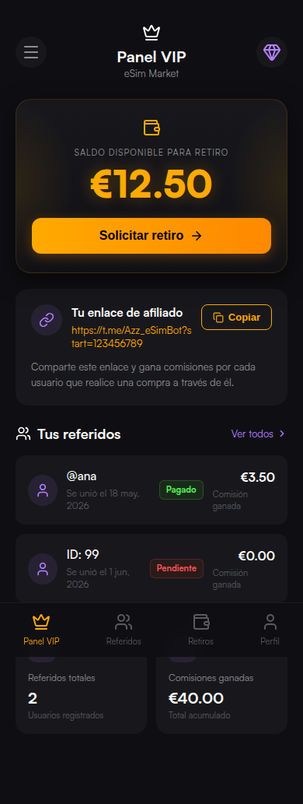

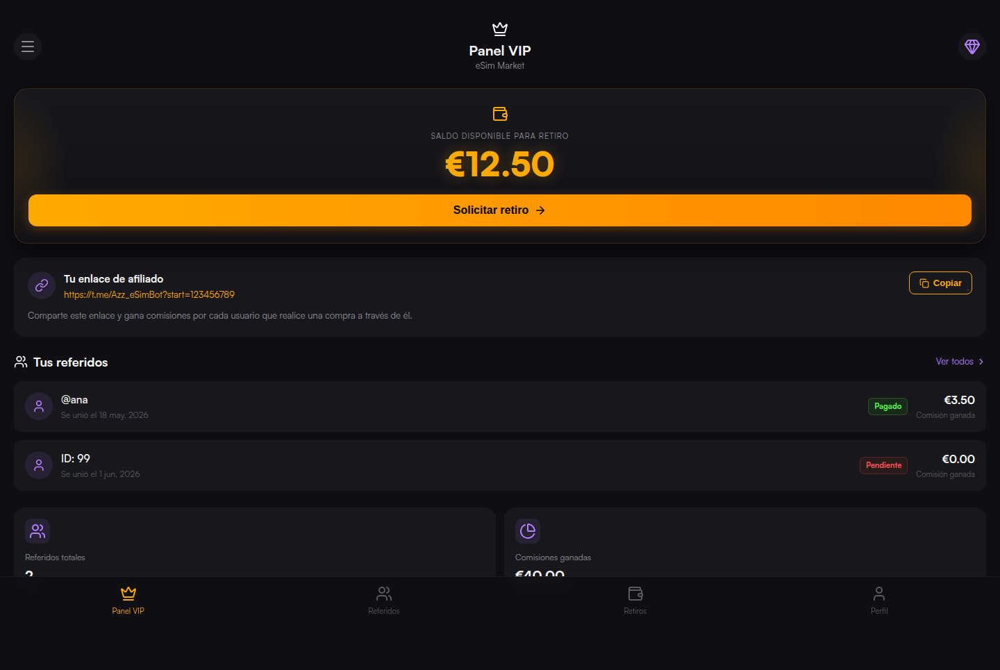

### 6.3 Admin, `stats.html`

Título `Panel Admin · eSim Market` (línea 6). No carga el script de Telegram. No es una mini app: es un panel que espera un `api_base` y un `token` en la query (236-238).

Tokens oscuros, líneas 10-23, y claros, líneas 24-34:

| | Oscuro (`:root` y `[data-theme="dark"]`) | Claro (`[data-theme="light"]`) |
|---|---|---|
| `--bg` | `#0b0c10` | `#f4f6fb` |
| `--bg2` | `#15161c` | `#ffffff` |
| `--bg3` | `#1e222d` | `#eef1f8` |
| `--text` | `#ffffff` | `#1a1d26` |
| `--muted` | `#8b8e98` | `#6b7280` |
| `--accent` | `#b89aff` | `#7c5ce0` |
| `--accent2` | `#2ed573` | `#16a34a` |
| `--border` | `rgba(255,255,255,0.06)` | `rgba(0,0,0,0.08)` |
| `--card-shadow` | `0 10px 25px rgba(0,0,0,0.3)` | `0 4px 16px rgba(0,0,0,0.08)` |
| `--success` | `#2ed573` | hereda el de `:root` si no se repinta |
| `--warning` | `#ffa502` | igual |
| `--danger` | `#ff4757` | igual |

El claro no redeclara `--success`, `--warning` ni `--danger`. Siguen en `#2ed573`, `#ffa502` y `#ff4757`. El HTML arranca en `data-theme="dark"` (línea 2). El botón `#themeToggle` alterna y cambia el carácter entre `🌙` y `☀️` (765-770). Es el único claro/oscuro del repositorio, y es del admin.

Fuente: `-apple-system, BlinkMacSystemFont, 'Segoe UI', Roboto, sans-serif` (40). No cita SF Pro Display.

Layout: `.app-shell` en flex y alto `100dvh` (44-45). Sidebar de 220 px (46). A `max-width: 900px` el sidebar se oculta, aparece `.mobile-nav` fijo abajo y las rejillas de 4 y de 2 pasan a 2 y a 1 (135-150). A `max-width: 480px` los KPI pasan a una columna (151-153). Por eso a 1440 px el admin se ve como un panel y a 390 px como una pila. Es la pieza al revés que la tienda: el escritorio es su caso bueno.

Pantallas, solo dos, por atributo `data-page`: `ventas` y `comisiones`. Textos de navegación: `📊 eSim Admin`, `💰 Ventas`, `🤝 Comisiones`.

Píldoras de fecha: `Hoy`, `7 días`, `30 días`, `Este mes`, `Histórico`. El HTML marca `Hoy` como activa (167). El script, al final, activa `30d` y pide datos de los últimos 30 días (793-795). `7 días` es hoy inclusive menos 6. `30 días` es hoy inclusive menos 29. `Este mes` es del día 1 al hoy. `Histórico` enseña dos `<input type="date">` y el botón `Aplicar`. Si falta una fecha: `alert("Selecciona ambas fechas")` (760).

KPI de ventas (390-414): `Ingresos Reales`, `Ventas eSIMs`, `eSIMs vendidas`, `Ticket medio`. Subtextos: el desglose `{método}: €{entero}` unido con ` · `, `{n} pedidos`, `unidades`, `por venta completada`. Los números se animan desde 0 en 800 ms con ease-out cúbico (309-322) y coma decimal en `es-ES`.

Gráficos (Chart.js, línea 8): `Evolución diaria` con series `Ingresos (€)` en `#2ed573` y `Ventas (€)` en `#b89aff`; `eSIMs por tarifa` de donut; `Top 5 tarifas`; `Por semana` con semanas `S{n}`. Colores de donut, en orden: `#b89aff`, `#2ed573`, `#ffa502`, `#70a1ff`, `#ff6b81`, `#5352ed` (455).

Tabla `Transacciones` y botón `⬇ Exportar CSV`. Columnas: `Fecha`, `Usuario`, `Producto`, `Importe`, `Método`, `Estado`. Vacío: `Sin transacciones` / `No hay datos en este período. Prueba ampliar el rango de fechas.` (528).

KPI de comisiones (564-572): `Comisiones generadas`, `Comisiones pagadas` con subtexto `retiradas / liquidadas`, `Comisiones pendientes` con `saldo VIP retirable`, `VIPs activos` con `con al menos 1 comisión`.

«Pagadas» no es un campo. Es `max(0, suma de commission_generated − suma de affiliate_balance)` (560). El KPI de VIPs activos cuenta afiliados con comisión en el periodo o con alguna línea de log (561). La columna Estado de la tabla usa otra condición: comisión del periodo mayor que 0, o `total_referrals > 0` (587). Un VIP puede salir activo en la tabla y no contar en el KPI, o al revés.

Tabla `Afiliados VIP`. Columnas: `VIP`, `Clientes`, `Ventas (€)`, `Comisión gen.`, `Pagada`, `Pendiente`, `Último referido`, `Estado`, y un botón `▼` / `▲`. Badges `Activo` e `Inactivo`. Vacío: `Sin afiliados VIP` / `No hay VIPs registrados o sin actividad en este período.` (603).

Detalle al expandir: `Cliente`, `Fecha alta`, `Ventas`, `Comisión`, `Última venta`. Vacío: `Este VIP aún no ha traído clientes.` (675). Error de red: `Error al cargar referidos` (668).

Badges de estado de una transacción (300-307): `completado`, `completed`, `credited` o `finished` → `Completado`. `pendiente`, `pending` o `waiting` → `Pendiente`. Cualquier otro valor se imprime tal cual, o `Fallido` si viene vacío.

Método de pago, solo como etiqueta a partir de los campos `method` y `provider` (290-298): si `method` contiene `paypal` → `PayPal`; `stripe` → `Stripe`; `cripto` o `crypto`, o `provider` contiene `nowpayment` → `Crypto`; si hay method y no encaja → el texto original; si no hay nada → `Otro`. Las ventas de eSIM se etiquetan siempre `Saldo` (504). Las recargas se etiquetan con el producto fijo `Recarga de saldo` (507). Esto dice qué cadenas espera el admin. No dice que la tienda integre esas pasarelas: `index.html` no las nombra.

Llamadas HTTP, las únicas del repositorio. GET, sin body. Cabecera única: `ngrok-skip-browser-warning: true` (239). El token va en la query, no en `Authorization`.

1. `{api_base}/api/admin-stats-extended?token&from_d&to_d` (716).
2. `{api_base}/api/admin-vip-detail?token&from_d&to_d&referrer_id` (662).

`api_base` se lee de la query y se le quitan las barras finales (237). Si falta `api_base` o falta `token`: `alert("estadísticas no disponibles")` y no se llama a la red (710). Si el JSON trae `error`: `alert("Error en la API: " + data.error)` (718) o, en el detalle, el texto de `data.error` dentro de la fila (664). Si `fetch` falla: `alert("No se pudo conectar a la base de datos.")` (725).

Campos que el render lee de `admin-stats-extended`:

| Array | Campos usados |
|---|---|
| `orders` | `status`, `r` (importe), `q` (unidades), `d` (fecha), `p` (producto), `username`, `user_id` |
| `recharges` | `status`, `r`, `d`, `username`, `userid`, `method`, `provider` |
| `commission_logs` | `a` (importe), `d`, `rid` (id del afiliado) |
| `vip_affiliates` | `user_id`, `username`, `affiliate_balance`, `commission_generated`, `last_referral_at`, `total_referrals`, `sales_generated` |

Una recarga cuenta como ingreso si `status` es `completed`, `credited` o `finished`. Si `status` falta, se trata como `completed` (286-288). Un pedido solo cuenta como venta si `status` es exactamente `completado` (376). `completed` en inglés no entra en las ventas, pero sí en el badge de la tabla.

Campos del detalle VIP (678-685): `referrals[]` con `username`, `user_id`, `joined_at`, `sales_total`, `commission_total`, `last_order_at`.

El CSV se descarga en el cliente con BOM, nombres `transacciones.csv` y `vip_afiliados.csv` (699-707, 773-790). No hay endpoint de export.

Skeleton: degradado que se desplaza en 1.2 s (119-124). Es el estado que se ve si no hay API, porque `loadData` hace el `alert` y vuelve antes de sustituir el HTML inicial.

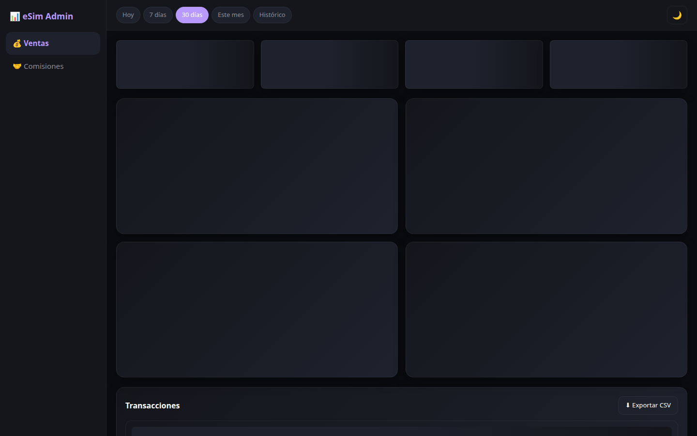

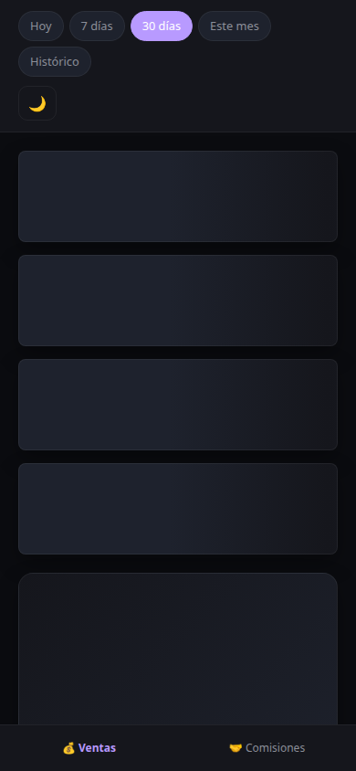

La definición dice que el panel de administración se hará más adelante. Este archivo ya existe, con otro contrato (token en query, dos GET, sin Telegram) y no debe copiarse como si fuera la tienda.

## 7. Todos los puntos de la web

Lista de lo que la web nueva tiene que conservar si la meta es que se reconozca la mini app vigente, más lo que la definición pide y aquí no está, más lo que aquí está y la definición no nombra. Cada punto es comprobable contra una línea o contra una captura.

### 7.1 Reglas visuales que salen de `index.html`

- [ ] Fondo de página `#0b0c10`, el mismo que `tg.setHeaderColor` y `tg.setBackgroundColor` (`index.html` 32, 685-686).
- [ ] Tarjeta de saldo con degradado `135deg` de `#1e222d` a `#0d0f14`, radio 20 px, padding 24 px, borde `rgba(255,255,255,0.05)` (44-52). La sombra visible es la de `.violet-ui`, no la `0 15px 35px` declarada en `.virtual-card`: las dos clases están en el mismo nodo y `box-shadow` no se acumula (apartado 1.7).
- [ ] Brillo radial blanco al 3 % rotado 30 grados, recortado por `overflow: hidden` (54-61).
- [ ] Anillo violeta de `.violet-ui`: `0 0 0 1px rgba(173,124,255,0.18)`, sombra `0 10px 24px rgba(0,0,0,0.26)` y glow `0 0 18px rgba(173,124,255,0.08)`, texto `#d9dbe3` (552-555).
- [ ] Logo `1000007639.png`: chip metálico con «e». En el splash, 180 px, radio 24, `object-fit: contain`, drop-shadow `0 0 20px rgba(173,124,255,0.18)`. En la tarjeta, 28 px, drop-shadow de 10 px (578, 589).
- [ ] Wordmark de la tarjeta: `eSim Market`, 18 px, peso 800, tracking 1 px, degradado metal (70-73, 537-547, 590).
- [ ] Degradado de texto, de arriba abajo: `#f4f5f8` 0 %, `#d9dce4` 26 %, `#b9bec8` 52 %, `#f0f2f6` 76 %, `#d7dbe3` 100 %, más las tres sombras de texto de las líneas 544-546.
- [ ] Etiqueta `Fondos Disponibles` a 12 px, mayúsculas, tracking 1 px, color `#d5d8e0` (84-90, 548-550, 595).
- [ ] Importe a 40 px, peso 700, tracking -1 px, texto metal. El `€` a 20 px en `#8b8e98`, separado 4 px, con coma decimal (92-104, 738-743).
- [ ] Tres acciones centradas, gap 20 px: `Recargar` (`fa-plus`), `Cupones` (`fa-ticket`), `Cerrar` (`fa-xmark`). Icono en caja 50×50, radio 16, fondo `#15161c`, glifo `#b89aff` a 20 px, etiqueta 12 px / 500 en `#d5d8e0` (603-616, 115-150).
- [ ] Pulsación del icono: escala 0.92 y fondo `#1c1d24` en 0.2 s (141-144).
- [ ] Grupos por operadora con icono a 18 px en `#b89aff` y título a 18 px / 700 en metal (158-174, 794-799).
- [ ] Iconos de grupo: rayo Vodafone, globo Lebara, M Movistar, barras para Orange y para el resto (774-778).
- [ ] Tarjeta de producto de 240 px, radio 24, padding 20, fondo `#15161c`, borde sutil, snap al inicio (227-239). Sombra visible: la de `.violet-ui`. La de `.product-card` queda pisada.
- [ ] Nombre de producto a 18 px, descripción a 12 px en `#d5d8e0` con alto de línea 1.4 en la clase, precio a 18 px (806-808, 273-278).
- [ ] Pastilla `OFERTA`: fondo `rgba(173,124,255,0.12)`, texto `#b89aff`, 10 px, peso 700, tracking 0.5 px, padding `4px 8px`, radio 8, a 15 px de la esquina (241-252).
- [ ] Botón `Comprar` metal: degradado vertical `rgba(42,42,50,0.96)` → `rgba(25,25,31,0.98)`, texto `#eceef3`, borde `rgba(173,124,255,0.26)`, radio 12, 14 px de tamaño, peso 700, padding 10 px (287-302, 556-565, 809).
- [ ] Fila con gap 15 px, padding horizontal 20 px y barra de scroll invisible (177-188).
- [ ] Pila tipográfica exacta de la línea 27, sin webfont.
- [ ] Splash de 800 ms con el PNG y el spinner blanco de 32 px, fundido de 0.6 s con `cubic-bezier(0.25, 0.8, 0.25, 1)` y escala 1.05 (481-534, 731-733).
- [ ] Sheets desde abajo en 0.4 s con `cubic-bezier(0.175, 0.885, 0.32, 1.2)`, radio superior 30, asa de 40×4, velo negro al 50 % con blur de 4 px (305-344).
- [ ] Títulos de sheet a 22 px / 700, subtítulos a 14 px en `#8b8e98`, centrados (346-358).
- [ ] Input a 16 px, padding 16, radio 14, fondo `#0b0c10`, foco con borde `#b89aff` en 0.2 s (360-375).
- [ ] Botones `Continuar al Pago` y `Validar Código` con el metal de `.violet-btn`, 16 px, peso 600, radio 14, padding 16 (377-388, 556-565).
- [ ] Recibo con la última fila a 18 px / 700 y borde superior discontinuo (391-411).
- [ ] Stepper con botones de 40 px, radio 10, valor a 18 px / 600 y el sufijo literal ` uds.` también en singular (413-437, 653).
- [ ] Toast centrado arriba, radio 30, 3 s, icono de info en `#b89aff` (454-477, 566-568, 746-751).
- [ ] El botón de confirmar con saldo, tal como lo deja el JS: fondo `#c7cbd6` y texto blanco. El botón sin saldo: fondo `#15161c`, texto y borde `#ff4757`, rótulo `Saldo Insuficiente` (853-866). Está en las capturas `index-390-compra.png` e `index-390-compra-saldo.png`. Si se prefiere el metal de la clase CSS en lugar de este plata, es una decisión, no lo que la página enseña hoy. Pregunta 2.
- [ ] Violeta de icono `#b89aff` y violeta de brillo `rgb(173, 124, 255)` como dos valores distintos.
- [ ] Sin tema claro en la tienda. Sin leer `themeParams`.
- [ ] Sin zoom de usuario (`user-scalable=no`), sabiendo que eso no arregla el escritorio.

### 7.2 Textos literales de la tienda vigente

- [ ] `<title>`: `eSIM Market`
- [ ] `eSim Market`
- [ ] `Fondos Disponibles`
- [ ] `€` detrás de la cifra, con coma decimal y dos decimales
- [ ] `Recargar`
- [ ] `Cupones`
- [ ] `Cerrar`
- [ ] `Añadir Fondos`
- [ ] `Introduce la cantidad que deseas depositar`
- [ ] Placeholder `5.00`
- [ ] `Continuar al Pago`
- [ ] `Canjear Cupón`
- [ ] `Introduce el código promocional`
- [ ] Placeholder `CÓDIGO`
- [ ] `Validar Código`
- [ ] `Confirmar Compra`
- [ ] ` uds.`
- [ ] `Producto`
- [ ] `Precio Ud.`
- [ ] `Total a pagar`
- [ ] `Confirmar Pago`
- [ ] `Saldo Insuficiente`
- [ ] `OFERTA`
- [ ] `Comprar`
- [ ] `El ingreso minimo es de 5€`
- [ ] `Introduce un código`
- [ ] `Recarga saldo primero`
- [ ] `Conexión premium` cuando el producto no trae descripción
- [ ] Nombres de grupo `Vodafone`, `Lebara`, `Movistar`, `Orange`, `Otras Tarifas`
- [ ] Reserva, si se conserva este comportamiento: `Vodafone` / `90GB Llamadas` y `Lebara` / `90GB Data Only`, ambos a 12,99 €

### 7.3 Comportamiento de la tienda vigente

- [ ] Una sola página. Tres hojas inferiores. Un toast. Un splash. Sin rutas.
- [ ] Cerrar la hoja solo con el velo.
- [ ] `Cerrar` llama a `tg.close()` sin payload.
- [ ] El saldo entra por query `balance` y se pinta con coma.
- [ ] El catálogo entra por query `products` en base64 tras `decodeURIComponent`.
- [ ] Campos leídos: `id`, `name`, `description`, `unit_price`.
- [ ] Descuento por volumen solo si el id es `vodafone` o `lebara`, con los tramos 20→10 €, 10→11 €, 5→12 €, 2→12,50 €, aplicados en ese orden.
- [ ] Cantidad de 1 a 50.
- [ ] Pastilla `OFERTA` ligada a ese descuento, no al nombre.
- [ ] Payload de compra con `type`, `productId`, `productName`, `quantity`, `unitPrice`, `totalPrice`, `originalTotal`, `discountAmount`, números, y cierre inmediato.
- [ ] Payload de recarga `{type:"add_balance", amount}` con `amount` numérico, y el rechazo actual de cualquier valor `<= 5`.
- [ ] Payload de cupón `{type:"apply_coupon", code}` con el texto recortado, sin pasarlo a mayúsculas, y cierre inmediato.
- [ ] Háptico `light` en tarjeta, Comprar y stepper. Háptico `medium` en continuar al pago y validar código.
- [ ] Sin estado de éxito dentro de la página: el WebApp se cierra.
- [ ] Sin pantalla vacía: un catálogo ilegible o vacío enseña el reserva de dos productos.

### 7.4 Lo que la definición pide y esta mini app no tiene

La definición está en `definicion-web.md`. Aquí «no está» significa que `index.html` no lo pinta y no lo llama. Si una pieza existe solo en el parche o en el admin, se dice en qué archivo.

- [ ] «Sus compras.» No hay lista de pedidos, ni detalle, ni estado. El admin sí lista transacciones, en `stats.html`, con otro acceso.
- [ ] «El catálogo, con carrito.» El catálogo vigente es una fila por operadora y la compra es de un producto. El carrito existe como pantalla en `project/indexparche7.0.html` y ningún botón llama a `addToCart` (1008). El checkout de ese archivo, si se llenara la cesta por consola, mandaría solo la primera línea con el total de todas (1110-1130).
- [ ] «El alquiler de números SMS.» No está en ningún HTML del repo.
- [ ] «Un buscador de eSIM por país.» No hay campo de búsqueda ni países.
- [ ] «Recarga de saldo con pasarela propia.» La tienda solo manda `add_balance` y se cierra. No hay URL de pago. El admin sabe etiquetar `PayPal`, `Stripe`, `Crypto` / `nowpayment` y `Saldo` (`stats.html` 290-298 y 504), lo que indica que quien alimenta esa API guarda un `method` y un `provider`. Esa API no está en el repo.
- [ ] «Historial unificado con compras, recargas y facturas.» No hay facturas en ningún archivo. El admin compone una tabla de pedidos y recargas, sin facturas.
- [ ] «Si el pago se abandona, el enlace se puede retomar.» No hay id de pago ni URL de reanudación.
- [ ] «Desde la web, el soporte lleva a Telegram.» No hay botón de soporte. El único enlace es el de afiliado `https://t.me/Azz_eSimBot?start={user_id}` en `affiliates.html` 556. El parche escribe `Soporte 24/7` y no enlaza nada (697-699).
- [ ] «Allí el bot reconoce la cuenta y de dónde viene el usuario, abre un ticket y lo escala a Aiman.» El bot no está en este repo. La tienda no manda origen ni id de usuario.
- [ ] «Se replican en la web» las reseñas. La tienda vigente no tiene reseñas. El parche tiene tres textos fijos de `Anónimo` con cinco estrellas (659-680), no una fuente de datos.
- [ ] «Inicio de sesión con correo o con Telegram.» No hay formulario de correo. No se lee `initData`.
- [ ] «Verificación anti-bot inicial.» No está.
- [ ] «Notificaciones al usuario.» No hay bandeja ni push. Solo toasts de validación.
- [ ] «Se reutiliza la mini app actual, con un menú lateral.» La mini app actual no tiene menú lateral. El lateral de 220 px es del admin (`stats.html` 45-52) y sus ítems son Ventas y Comisiones.
- [ ] «Aspecto profesional» y «funcionar bien en ordenador y en móvil.» La tienda no tiene ni una media query. El apartado 5 describe el hueco. Hacer que funcione en escritorio obliga a decidir un contenedor; el código de hoy no lo tiene.
- [ ] «El bot deja de ser una tienda. El catálogo, el pago y la entrega pasan a la web.» Hoy el catálogo entra por query, el pago es un `sendData` y la entrega no tiene UI.
- [ ] «Qué hacer con los saldos que tienen ahora los clientes.» Este repo solo recibe un número ya calculado. No hay libro de saldos.
- [ ] «El panel de administración, que se hará más adelante.» `stats.html` ya está, con los dos GET del apartado 6.3. La definición lo deja fuera de esta fase.

### 7.5 Lo que la mini app tiene y la definición no nombra

- [ ] Cupones (`Canjear Cupón` / `apply_coupon`). Están en la tienda y en el parche.
- [ ] El botón `Cerrar` que llama a `tg.close()`.
- [ ] El descuento por volumen de Vodafone y Lebara, con precios fijos en el cliente.
- [ ] La tarjeta tipo monedero, el splash y el PNG del chip.
- [ ] El háptico `light` y `medium`.
- [ ] La agrupación visual por operadora.
- [ ] La pastilla `OFERTA`.
- [ ] El tope de 50 unidades y el mínimo de 1.
- [ ] El estado `Saldo Insuficiente` en el propio botón.
- [ ] El panel VIP: enlace `t.me/Azz_eSimBot`, referidos, badges `Pagado` y `Pendiente`, retiro mínimo de 5,00 € con `withdraw_request`. Paleta oro, fuente Satoshi. No está en la definición de la web de cliente.
- [ ] En el parche, y no en la definición: SIM física, envío InPost de 5 € no multiplicado por cantidad, stock con botón `Sin stock`, etiquetas `5G` y `Entrega inmediata`, categorías `eSIMs Digitales` y `SIMs Físicas`, franja de beneficios, avatares de operadora en colores de marca (rojo Vodafone, azul Lebara, naranja Orange, azul Movistar).
- [ ] En el admin, y la definición lo aplaza: KPI, gráficos, CSV, tema claro, token en query.

### 7.6 Preguntas abiertas para el dueño

1. ¿La identidad a copiar es `index.html` del 22 de junio de 2026 (metal, `#0b0c10`, chip con «e»)? El parche del 11 de junio es otra marca (`#7c3aed`, `#09090f`, icono `fa-sim-card`, foto del mapamundi). Las dos siguen en el repo. Las capturas de las dos están en `docs/screenshots/` para poder compararlas sin abrir el código.
2. «Confirmar Pago» no se ve con el botón metal. En cuanto se abre la hoja, el JS lo pone en `#c7cbd6` con texto blanco (`index.html` 861-862 y captura `index-390-compra.png`). «Comprar», «Continuar al Pago» y «Validar Código» sí son metal. ¿La web repite esa diferencia o unifica?
3. ¿El nombre oficial es `eSIM Market` (título de la tienda y marca del parche), `eSim Market` (tarjeta vigente, subtítulo del VIP) o `eSim market` (el JPEG `1000006996.jpeg`, que ningún HTML usa)?
4. ¿`1000006996.jpeg` es un logo a conservar o un archivo suelto? Mide 1037×1060 y no está referenciado.
5. ¿Qué hace el bot al recibir `purchase`, `add_balance` y `apply_coupon`? El QR, la URL de la pasarela, el resultado del cupón y el número de pedido no están en este repositorio. Sin eso no se puede describir la entrega ni «retomar el pago».
6. La recarga dice «mínimo 5 €» y el código rechaza 5.00 porque la condición es `val <= 5` (897-898). ¿El mínimo es «más de 5» o «5 o más»? El parche no tiene ese mínimo: acepta cualquier importe mayor que 0 y manda `amount` como string (`indexparche7.0.html` 1143-1144). La tienda lo manda como número. ¿Cuál de los dos contratos usa el bot?
7. ¿Los tramos 20/10/5/2 euros siguen vigentes y solo para los id `vodafone` y `lebara`? Un producto que se llame Vodafone con otro id no tiene tramo ni pastilla. El catálogo de reserva, además, no usa los mismos tramos que el catálogo de la query (710-714 frente a 722-723).
8. La definición exige carrito. La tienda vigente no lo tiene. El del parche no se puede llenar desde la UI y, si se llena, el checkout manda un solo producto con el total de la cesta. ¿La web parte de cero en el carrito?
9. ¿Las reseñas de la web son las tres frases fijas del parche o hay una fuente que no está en este repo?
10. SMS y búsqueda por país no tienen pantalla, ni modelo, ni endpoint aquí. ¿Dónde está ese catálogo?
11. ¿La web vende SIM física con 5 € de InPost, como el parche, o solo eSIM, como la tienda vigente y como la definición?
12. ¿El cliente web debe incluir el panel VIP y el admin, o se quedan fuera? Son otras dos identidades (oro Satoshi, y el admin con tema claro). La definición deja el admin para más adelante y no menciona el VIP.
13. ¿El script de la línea 3 de `index.html`, servido desde `ppl-ai-code-interpreter-files.s3.amazonaws.com`, es intencionado? No participa en la interfaz. No se ejecutó al capturar.
14. El icono NFC de la tarjeta no se ve: Font Awesome 6.0.0 no trae `fa-nfc-symbol` (línea 8 y línea 592). La 6.4.0 sí lo trae, y es la que carga el parche. ¿La tarjeta debe mostrar el símbolo NFC?
15. Orange comparte `fa-signal` con «Otras Tarifas». ¿Es provisional o es la regla?
16. No hay `initData` en el cliente. La definición pide entrar con Telegram o con correo, más un anti-bot. ¿La validación de Telegram vive en algún sitio fuera de este repo, y el anti-bot es el «9+4» o el botón que citan las notas?
17. El único deep link es `https://t.me/Azz_eSimBot?start={user_id}` para afiliados. ¿Qué `start` debe abrir un ticket de soporte e identificar que el usuario viene de la web?
18. Idioma y moneda: todo el repo de cliente está en español y en euros, con dos formatos (coma y símbolo detrás en la tienda; punto y símbolo delante en el VIP). ¿La web se queda así?
19. ¿El catálogo de reserva de dos productos debe desaparecer en la web? Hoy un `products` vacío o roto enseña Vodafone y Lebara de mentira y el usuario puede intentar comprarlos.
20. Saldos ya existentes: este front solo recibe el número. La decisión sigue fuera del código, como ya dice la definición.
